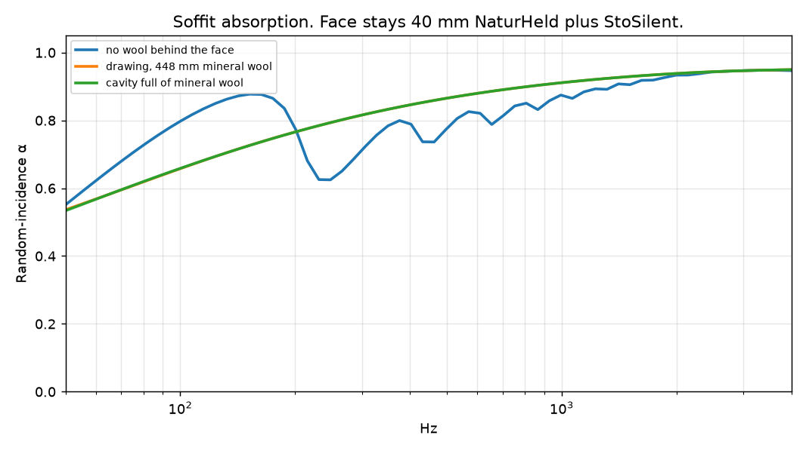
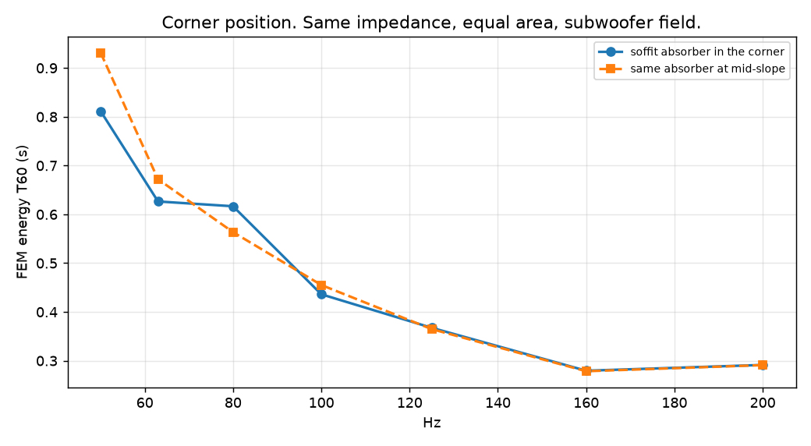
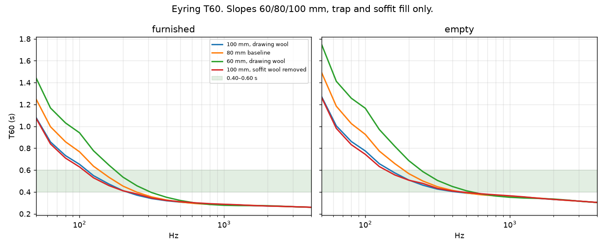
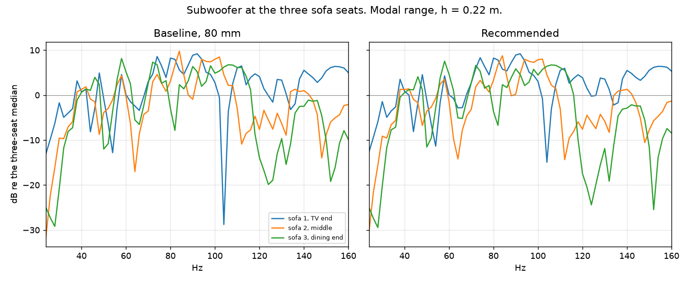

# Obývák fill and slope

The outlines stay as drawn. StoSilent on the slopes and on the soffit face stays. The slope board is 60, 80 or 100 mm of NaturHeld 140. Inside the soffit (774 mm of wool plus air) and inside the two traps (kitchen cavity 178 mm with at least 47 mm of air, living cavity 438 mm with at least 20 mm of air) the wool thickness and the wool type can change. Wool is mineral wool at 12 000 Pa·s/m² or wood-fibre flex at 8 000 Pa·s/m².

Decay times from 50 Hz to 4 kHz are Eyring on the mesh areas, with air absorption. The sofa is a domestic upholstery curve, not a porous block: α = 0.15 at 63 Hz and 0.68 at 500 Hz, rising to about 0.75 near 1 kHz. See the citation under Furniture. The rug is the thin-carpet Miki layer already in the model. Books are a shelf curve that keeps the transfer-matrix bass and does not collapse at 4 kHz.

Recommended: **100 mm, mineral wool, soffit wool 448 mm, kitchen 130 mm, living 300 mm**. Furnished mids (500 and 1 kHz) 0.30 s, bass (50–80 Hz) 0.89 s. The mids barely move between 60 and 100 mm. The 100 mm board is the change that shortens the bass. Emptying the soffit, swapping wool type, or filling the living trap past the drawing is inside 5% and is not recommended.

## Furniture absorption

The previous sofa was a 0.40 m layer at 8 000 Pa·s/m². On the 18 m² of sofa surface that is α ≈ 0.60 at 63 Hz, about 11 m² Sabine, which is why the bass came out under 0.30 s. A domestic sofa does not do that.

The curve used now is the fabric-seat octave shape (about 0.15 at 125 Hz, 0.6 at 500 Hz, 0.7 at 1–2 kHz), with 63 Hz held at 0.15. It is checked against ISO 354 measurements of the Offecct Lucy 2-seater (SP report 18-106-M8, 12 April 2018): equivalent absorption area 1.30 m² at 63 Hz and 3.28 m² at 500 Hz, measured standing on the floor. Two of those sofas, spread over this L's 18 m² of meshed surface, are α ≈ 0.14 at 63 Hz and α ≈ 0.36 at 500 Hz. The Lucy is an acoustic product, so it is an upper bound for a normal sofa at bass. The table here is 0.15 at 63 Hz and 0.68 at 500 Hz: the bass matches the measured objects, and the mids follow the architectural fabric-seat tables rather than an acoustic sofa that is already absorbing at 63 Hz.

Books. The lamella model (20 mm gap, no wool, half the wall as 120 mm of books at 40 000 Pa·s/m²) gives α ≈ 0.12 at 63 Hz and 0.45 at 500 Hz, then falls to ≈ 0.12 at 4 kHz. The bass is already sane. The 4 kHz collapse is the thin gap, not a shelf of books. Cox and D'Antonio, Acoustic Absorbers and Diffusers (2nd ed., 2009), treat book-filled shelving as a mid-frequency absorber. The curve used here keeps α = 0.10 at 63 Hz and 0.48 at 500 Hz, and holds 0.54 at 4 kHz.

Rug. 12 mm at 20 000 Pa·s/m², Miki, random incidence: α ≈ 0.00 at 63 Hz, 0.02 at 250 Hz, 0.06 at 500 Hz, 0.14 at 1 kHz, 0.33 at 2 kHz, 0.69 at 4 kHz. A thin carpet on a hard floor is in the same place at bass (Beranek, Noise and Vibration Control, revised ed., 1988: on the order of 0.02–0.08 at 125 Hz). It was not absorbing the bass, so it stays.

## Empty and furnished T60

Seconds, Eyring, one-third octaves. The first columns are the best few furnished scores. Baseline is 80 mm NaturHeld with the drawing's wool.

### Furnished

| Hz | 100 mm, mineral wool, soffit wool 448 mm, kitchen 130 mm, living 300 mm | 80 mm, mineral wool, soffit wool 448 mm, kitchen 130 mm, living 300 mm | 60 mm, mineral wool, soffit wool 448 mm, kitchen 130 mm, living 300 mm | 100 mm, mineral wool, soffit wool 0 mm, kitchen 130 mm, living 300 mm |
| --- | ---: | ---: | ---: | ---: |
| 50 | 1.08 | 1.25 | 1.44 | 1.08 |
| 63 | 0.86 | 1.00 | 1.17 | 0.84 |
| 80 | 0.73 | 0.86 | 1.03 | 0.71 |
| 100 | 0.65 | 0.77 | 0.94 | 0.63 |
| 125 | 0.55 | 0.64 | 0.78 | 0.53 |
| 160 | 0.47 | 0.53 | 0.64 | 0.46 |
| 200 | 0.41 | 0.45 | 0.54 | 0.41 |
| 250 | 0.37 | 0.40 | 0.46 | 0.38 |
| 315 | 0.34 | 0.35 | 0.39 | 0.34 |
| 400 | 0.32 | 0.33 | 0.35 | 0.32 |
| 500 | 0.31 | 0.31 | 0.32 | 0.31 |
| 630 | 0.30 | 0.29 | 0.30 | 0.30 |
| 800 | 0.29 | 0.29 | 0.29 | 0.29 |
| 1000 | 0.29 | 0.28 | 0.28 | 0.29 |
| 1250 | 0.28 | 0.28 | 0.28 | 0.28 |
| 1600 | 0.28 | 0.28 | 0.27 | 0.28 |
| 2000 | 0.27 | 0.27 | 0.27 | 0.27 |
| 2500 | 0.27 | 0.27 | 0.27 | 0.27 |
| 3150 | 0.26 | 0.26 | 0.26 | 0.26 |
| 4000 | 0.26 | 0.26 | 0.26 | 0.26 |

### Empty

| Hz | 100 mm, mineral wool, soffit wool 448 mm, kitchen 130 mm, living 300 mm | 80 mm, mineral wool, soffit wool 448 mm, kitchen 130 mm, living 300 mm | 60 mm, mineral wool, soffit wool 448 mm, kitchen 130 mm, living 300 mm | 100 mm, mineral wool, soffit wool 0 mm, kitchen 130 mm, living 300 mm |
| --- | ---: | ---: | ---: | ---: |
| 50 | 1.27 | 1.49 | 1.74 | 1.26 |
| 63 | 1.00 | 1.18 | 1.41 | 0.98 |
| 80 | 0.86 | 1.03 | 1.26 | 0.83 |
| 100 | 0.77 | 0.93 | 1.17 | 0.74 |
| 125 | 0.66 | 0.77 | 0.97 | 0.63 |
| 160 | 0.57 | 0.66 | 0.82 | 0.56 |
| 200 | 0.51 | 0.57 | 0.69 | 0.51 |
| 250 | 0.46 | 0.50 | 0.59 | 0.48 |
| 315 | 0.43 | 0.45 | 0.51 | 0.43 |
| 400 | 0.40 | 0.41 | 0.45 | 0.41 |
| 500 | 0.39 | 0.39 | 0.41 | 0.40 |
| 630 | 0.38 | 0.37 | 0.38 | 0.38 |
| 800 | 0.37 | 0.36 | 0.36 | 0.37 |
| 1000 | 0.36 | 0.36 | 0.35 | 0.37 |
| 1250 | 0.35 | 0.35 | 0.34 | 0.36 |
| 1600 | 0.34 | 0.34 | 0.34 | 0.34 |
| 2000 | 0.33 | 0.33 | 0.34 | 0.33 |
| 2500 | 0.32 | 0.32 | 0.33 | 0.32 |
| 3150 | 0.31 | 0.31 | 0.31 | 0.31 |
| 4000 | 0.30 | 0.30 | 0.30 | 0.30 |

## Soffit α(f) and the corner

The soffit face is fixed: StoSilent plus 40 mm NaturHeld. The plot is the random-incidence absorption of that face with the wool behind it. The corner run uses the recommended fill. The moved case puts the same impedance on 11.8 m² of slope nearest the false ridge (X = 2.45 m) and gives the corner step the slope build-up instead. Geometry of the step does not change.

| Hz | corner T60 s | mid-slope T60 s | difference s |
| --- | ---: | ---: | ---: |
| 50 | 0.812 | 0.931 | +0.120 |
| 63 | 0.626 | 0.672 | +0.046 |
| 80 | 0.617 | 0.564 | -0.053 |
| 100 | 0.436 | 0.455 | +0.019 |
| 125 | 0.367 | 0.365 | -0.003 |
| 160 | 0.279 | 0.278 | -0.001 |
| 200 | 0.291 | 0.291 | -0.000 |

## How it would sound

DIN 18041:2016 does not cover dwellings. Its nearest speech formulas, if this 218 m³ furnished volume is inserted anyway, are A3 teaching/communication 0.58 s and A4 inclusive 0.47 s, both judged on the 500–1000 Hz average, with the usual ±20% band from 250 Hz to 2 kHz. The aim here is tighter: 0.4–0.6 s in the mids, and bass not much longer than that. A change under about 5% is the just-noticeable difference for decay time.

Furnished, the recommendation sits at 0.30 s on 500–1000 Hz and 0.89 s on 50–80 Hz (bass/mid = 3.01). 2–4 kHz is 0.27 s, and the speech average 500–2000 Hz is 0.29 s. The empty room at the same build is 0.38 s in the mids: the sofa is what brings the lived-in room down.

From about 250 Hz upward the decay is shorter than 0.4 s. Speech stays clear, and a bit dry: there is little tail on a voice. The slope area is what does this. 60 mm of NaturHeld is already enough that 80 mm and 100 mm do not change the mids by an amount anyone would hear. Getting the mids up into 0.4–0.6 s would mean less slope absorption, which this search is not allowed to do.

The bass decay is 3.01 times the mids. On music and films the low notes hang on after the mids have died. That is the boom. It is a decay mismatch, not a loudness peak. Speech, which lives above a couple of hundred hertz, is the dry part, not the boomy part.

Against the current 80 mm build (80 mm, mineral wool, soffit wool 448 mm, kitchen 130 mm, living 300 mm), the mids move from 0.30 s to 0.30 s and the bass from 1.04 s to 0.89 s.

Shared subwoofer peaks at the seats: 58 Hz (about 7 dB above the local level), 38 Hz (about 7 dB above the local level), 140 Hz (about 5 dB above the local level), 74 Hz (about 3 dB above the local level). A broad cut at each of those, Q around 2 to 4, of roughly that many decibels, brings the note back to the seats' own average. It does not change the decay time of the room. The three seats move together at those peaks, so one house curve covers them. The TV-end seat also has a deep notch near 105 Hz. That is a seat null. Do not boost it.

Moving the same soffit absorber to mid-slope changes the subwoofer's energy T60 by at most +0.120 s in the bands that were solved. Above a couple of hundred hertz the position stops mattering: Eyring only sees the area.

## Limits

Eyring does not know where a surface sits. The corner comparison is the FEM energy decay of this subwoofer, h = 0.22 m, six elements per wavelength up to about 260 Hz. 4 kHz is statistical only.
Locally reacting surfaces. The sofa and the shelf are a real β = α/4 so the energy decay matches the published α. Slopes, soffit and traps use the layer stack, field-averaged for Eyring and normal-incidence for the FEM.
Upholstery σ is no longer in the model. The α table is still a type, not a measurement of this sofa.

