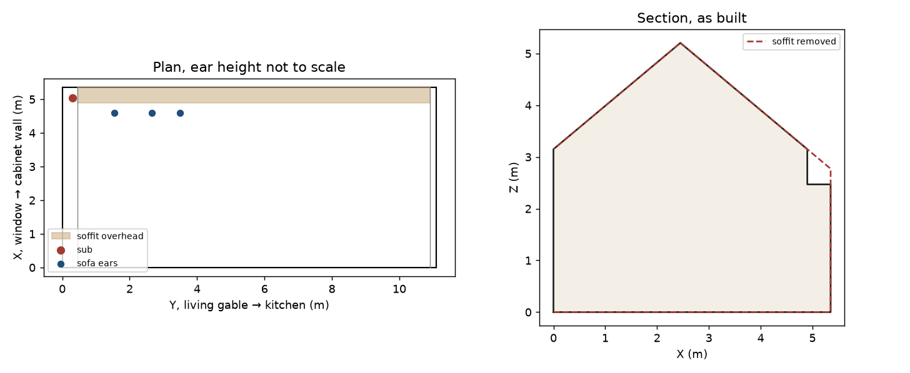
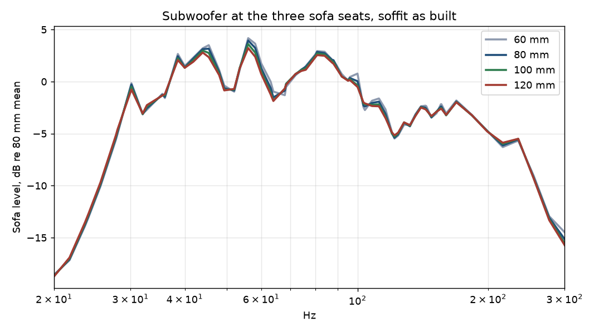
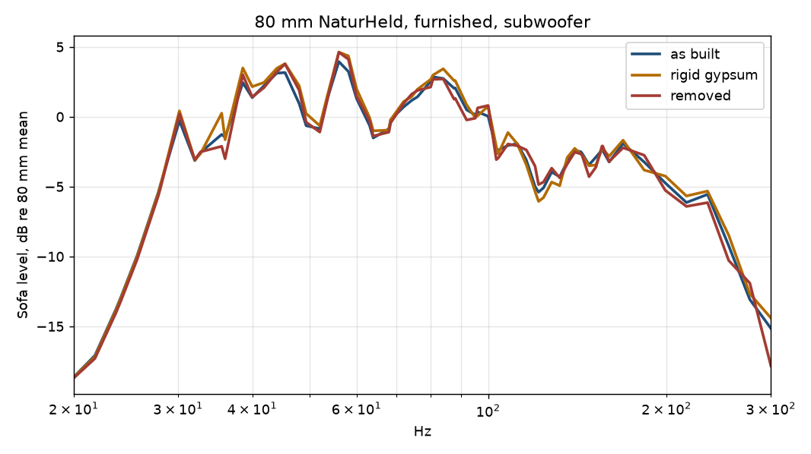
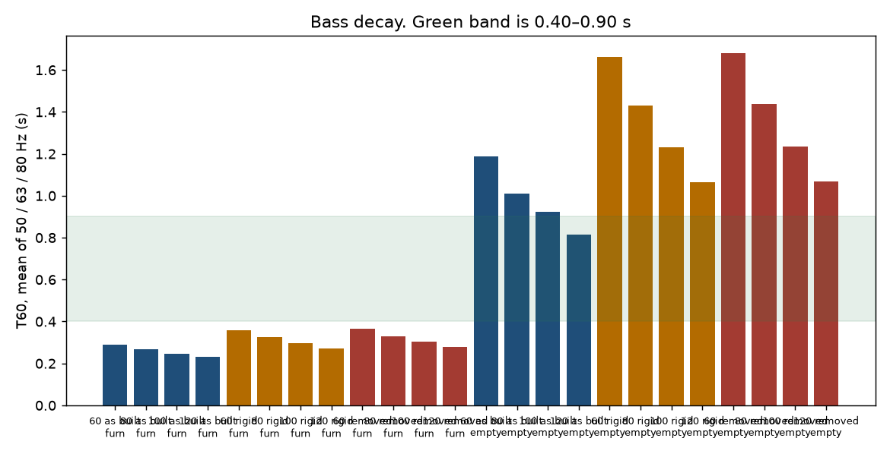
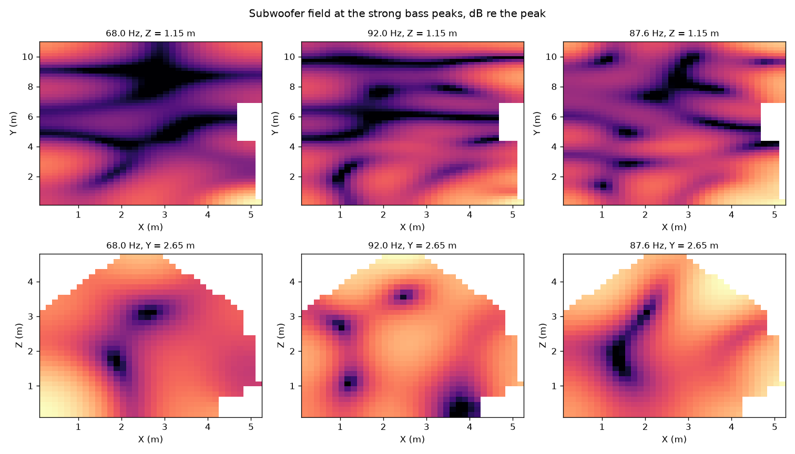
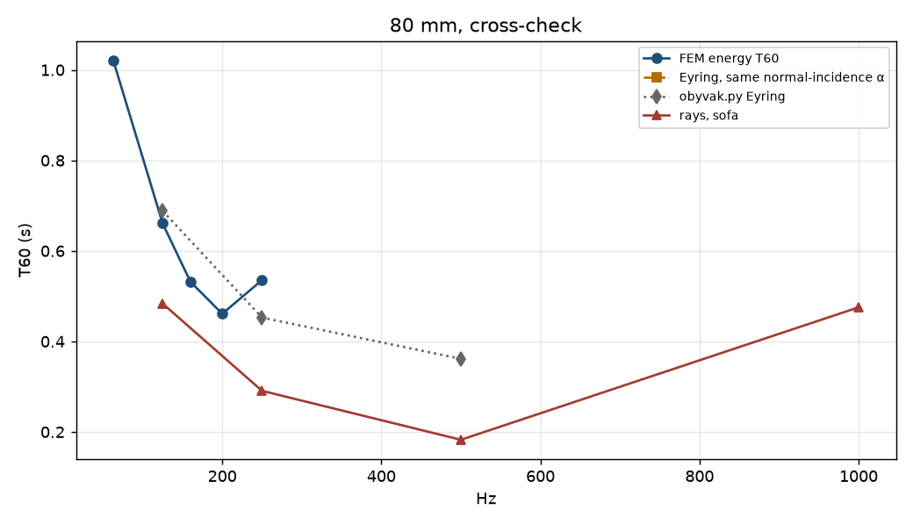

# Obývák wave acoustics

How thick should the NaturHeld 140 on the šikminy be, once the kastlík in the
slope/wall corner is allowed to move the room modes and not only the absorbing area?

## What was solved

The air volume is the obývák section: false ridge, both slopes, the living trap face
at Y = 0.45 m (the gable wall is Y = 0), above Z = 2.45 m,
and the kitchen trap face at Y = 10.91 m. As built, the kastlík
is the step at X = 4.90 m from Z = 3.15 m
down to Z = 2.47 m, then across to the cabinet wall.
Removed means that step is gone and the šikmina plane continues to the wall;
the new piece of ceiling is rigid (the lid), so it does not add slope absorption.
Rigid gypsum keeps the step and sets its impedance to a hard wall.

Slope impedance is StoSilent (2 + 2 mm) on NaturHeld 140, rigid-backed, from
`layers.surface_impedance` at normal incidence. The 80 mm gap under the rafters
(Unifit 032 on the window side, Isover Domo Plus on the cabinet side) stays behind
the GKF and is not part of the room impedance, same as the Eyring model.
Soffit impedance is the 40 mm NaturHeld face, the mineral wool, and the duct void.
Gable faces use the membrane model: kitchen 625 mm vertical, living 1000 mm
horizontal, taped sheet, as-built wool. The underside of each trap is the limp
stack of that same wool and air. Floor, plaster, and glass use a real β = α/4
with the Eyring coefficients 0.05, 0.04, and 0.03.

The subwoofer is a monopole on the floor in the living corner, 0.30 m from the
cabinet wall and 0.30 m from the living gable. TV speakers sit on that gable.
A talker stands where the dining table was, mouth at 1.50 m. Ears are at 1.15 m:
three sofa seats, the former dining position, and the former island position.
The L-sofa is a 0.40 m porous block (σ = 8000 Pa·s/m²). Tall cabinets and the
kitchen counters are hard. The island, the dining table, the fridge, and the
oven are not in the model. Chairs, the hood, and the open shelf are not either.
The bookshelf is a boundary on the cabinet wall (20 mm lamella gap, no wool,
half books), cut off at the soffit underside. The rug is a 12 mm porous patch.
No curtains. Full-height cabinets from the drawing are not in this air volume;
the furniture above replaces that placeholder.

Mesh size h = 0.22 m. Six elements per wavelength holds up to
260 Hz. At 300 Hz the mesh has 5.2 elements
per wavelength, which is short of six; the bass decision sits below 160 Hz,
where the mesh has 12.5 at 125 Hz. Linear tets, Gmsh.
A 20 mm move of the slope face between 60 mm and 120 mm of board is left out
of the geometry. It is smaller than the mesh and a much smaller mode shift
than the impedance change.

## Checks

Rigid box mode 34.30 Hz, FEM 34.42 Hz, error 0.36%.
Rigid box mode 42.88 Hz, FEM 43.12 Hz, error 0.57%.
Rigid box mode 54.91 Hz, FEM 55.43 Hz, error 0.95%.
Rigid box mode 57.17 Hz, FEM 57.75 Hz, error 1.02%.
Impedance tube against the closed form: relative pressure error 0.02%.
Uniform pressure, Sabine with α = 4β: FEM 1.024 s, formula 1.024 s.
Empty as-built volume 234.18 m³, analytic section 234.18 m³. The Eyring model volume is 221.6 m³; it stops the floor at the cabinet line, so it does not contain the bay under the kastlík.
Shoe-box axials of the plan: Y1 15.5 Hz, Y2 30.9 Hz, X1 32.1 Hz.
Rigid-wall modes of the empty room (no furniture, no absorption):
Mode 1: as built 15.80 Hz, soffit removed 15.81 Hz, shift +0.01 Hz.
Mode 2: as built 31.53 Hz, soffit removed 31.54 Hz, shift +0.02 Hz.
Mode 3: as built 34.27 Hz, soffit removed 34.06 Hz, shift -0.21 Hz.
Mode 4: as built 37.59 Hz, soffit removed 37.42 Hz, shift -0.16 Hz.
Mode 5: as built 39.14 Hz, soffit removed 39.27 Hz, shift +0.13 Hz.
Mode 6: as built 42.07 Hz, soffit removed 42.18 Hz, shift +0.11 Hz.
Mode 7: as built 46.37 Hz, soffit removed 46.26 Hz, shift -0.11 Hz.
Same as-built room on the coarser mesh: 15.81, 31.56, 34.31, 37.65 Hz. Differences from the study mesh are the spatial error on those modes.

## Bass at the sofa

T60 is the energy-balance decay of the subwoofer field (13.82 ∫|p|² dV) / (c ∫|p|² Re β dS). Inside a third octave the samples are weighted by ∫|p|². EDT is the early slope of a sum of those exponentials, extrapolated from −10 dB. One mode makes EDT equal T60. A mix of fast and slow decays makes EDT shorter.

| mm | soffit | furniture | T60 50–80 s | EDT 50–80 s | T60 100–125 s | smoothness dB |
| --- | --- | --- | ---: | ---: | ---: | ---: |
| 60 | as_built | yes | 0.29 | 0.29 | 0.18 | 2.08 |
| 80 | as_built | yes | 0.27 | 0.27 | 0.15 | 2.08 |
| 100 | as_built | yes | 0.25 | 0.25 | 0.14 | 2.04 |
| 120 | as_built | yes | 0.23 | 0.23 | 0.13 | 1.98 |
| 60 | as_built | no | 1.19 | 1.19 | 0.81 | 1.79 |
| 80 | as_built | no | 1.01 | 1.01 | 0.72 | 1.78 |
| 100 | as_built | no | 0.92 | 0.93 | 0.60 | 1.82 |
| 120 | as_built | no | 0.82 | 0.82 | 0.56 | 1.94 |
| 60 | removed | yes | 0.37 | 0.37 | 0.24 | 2.24 |
| 80 | removed | yes | 0.33 | 0.33 | 0.19 | 2.16 |
| 100 | removed | yes | 0.30 | 0.31 | 0.17 | 2.17 |
| 120 | removed | yes | 0.28 | 0.28 | 0.15 | 2.07 |
| 60 | removed | no | 1.68 | 1.68 | 1.15 | 1.82 |
| 80 | removed | no | 1.44 | 1.44 | 0.91 | 1.74 |
| 100 | removed | no | 1.23 | 1.24 | 0.78 | 1.75 |
| 120 | removed | no | 1.07 | 1.07 | 0.71 | 1.82 |
| 60 | rigid | yes | 0.36 | 0.36 | 0.23 | 2.41 |
| 80 | rigid | yes | 0.32 | 0.33 | 0.18 | 2.38 |
| 100 | rigid | yes | 0.30 | 0.30 | 0.16 | 2.39 |
| 120 | rigid | yes | 0.27 | 0.27 | 0.15 | 2.31 |
| 60 | rigid | no | 1.66 | 1.66 | 1.12 | 2.16 |
| 80 | rigid | no | 1.43 | 1.44 | 0.87 | 1.99 |
| 100 | rigid | no | 1.23 | 1.24 | 0.75 | 1.96 |
| 120 | rigid | no | 1.06 | 1.07 | 0.68 | 1.99 |

### Thickness, soffit as built, furniture in

60 mm: bass T60 0.29 s, EDT 0.29 s, 100–125 Hz 0.18 s, smoothness 2.08 dB.
80 mm: bass T60 0.27 s, EDT 0.27 s, 100–125 Hz 0.15 s, smoothness 2.08 dB.
100 mm: bass T60 0.25 s, EDT 0.25 s, 100–125 Hz 0.14 s, smoothness 2.04 dB.
120 mm: bass T60 0.23 s, EDT 0.23 s, 100–125 Hz 0.13 s, smoothness 1.98 dB.

Steps, furnished, as built:
60 → 80 mm: bass T60 -0.021 s (-7.4%, past 5%), smoothness +0.00 dB.
80 → 100 mm: bass T60 -0.021 s (-7.7%, past 5%), smoothness -0.04 dB.
100 → 120 mm: bass T60 -0.017 s (-6.9%, past 5%), smoothness -0.06 dB.
The seat spectra for these four thicknesses lie on top of each other. The step changes how fast the bass dies, not the pattern of the peaks.

### Soffit at 80 mm, furniture in

as_built: bass T60 0.27 s, EDT 0.27 s, 100–125 Hz 0.15 s, smoothness 2.08 dB.
rigid: bass T60 0.32 s, EDT 0.33 s, 100–125 Hz 0.18 s, smoothness 2.38 dB.
removed: bass T60 0.33 s, EDT 0.33 s, 100–125 Hz 0.19 s, smoothness 2.16 dB.
Absorption of the kastlík, same shape: as built minus rigid is -0.057 s on the 50–80 Hz mean. That is the corner material, not its position.
Position of the corner, both hard: rigid minus removed is -0.006 s on that mean. The modal frequencies of the empty rigid rooms are in the checks above; those shifts are the geometric effect with absorption taken out.
Furniture at 80 mm, as built: empty bass T60 1.01 s, with the sofa and kitchen 0.27 s.

## Above the Schroeder band

Schroeder's frequency is about 2000 √(T/V). For T = 0.6 s and V = 230 m³ it sits near 100 Hz, inside the 115–140 Hz range quoted for this room when T is a bit longer. The FEM number is the decay of this subwoofer field. The sub sits in the corner, against the living trap and the sofa, so the field is not diffuse and the decay is shorter than an area-weighted Eyring sum whenever those nearby surfaces absorb. That gap is the modal result. The Eyring numbers are the diffuse-room check, not a second copy of the same field.
80 mm, empty room, no sofa, statistical twin of this mesh (normal-incidence α, Eyring):
63.0 Hz: Eyring 1.58 s, FEM band 1.02 s.
125.0 Hz: Eyring 1.03 s, FEM band 0.66 s.
160.0 Hz: Eyring 0.84 s, FEM band 0.53 s.
200.0 Hz: Eyring 0.71 s, FEM band 0.46 s.
250.0 Hz: Eyring 0.60 s, FEM band 0.54 s.
Legacy Eyring (`obyvak.py` areas, field absorption on the slopes and soffit, panel field absorption on the gables) at 80 mm, soffit as built: 125.0 Hz 0.69 s, 250.0 Hz 0.45 s, 500.0 Hz 0.36 s. That model does not contain the sofa blocks.
Rays, furnished, 80 mm, as built, sofa histogram: 125.0 Hz 0.48 s, 250.0 Hz 0.29 s, 500.0 Hz 0.18 s, 1000.0 Hz 0.48 s. The rise at 1000 Hz is the short histogram, not a longer decay.

## Recommendation

A pleasant living room here means bass T60 between 0.40 s and 0.90 s, with 0.60 s as the middle of that window. Under 0.40 s is getting dead. Over 0.90 s on 50–80 Hz is the boom this corner is likely to have. A step inside 5% is not a reason to buy another thickness. Smoothness is the standard deviation of the third-octave sofa levels from 50 Hz to 160 Hz; lower is flatter. None of the four thicknesses lands in 0.40–0.90 s. With the sofa in the room every one is under 0.40 s, and thicker board is shorter. **60 mm** is the least dry and the closest to 0.60 s. The sofa, not the slope thickness, is what puts the bass under that window. Turning the kastlík from absorbent to rigid moves the 50–80 Hz T60 by +0.057 s, which is more than the largest thickness step (0.021 s). The corner lining matters more than the next 20 mm of slope board. The first rigid-room mode moves +0.01 Hz when the kastlík step is deleted. The largest shift in the first seven modes is 0.21 Hz. That is the position of the corner with absorption removed. The coarser mesh moves mode 3 by +0.05 Hz, so a shift of a few tenths of a hertz is above the mesh error and still too small to retune the bass. The loud subwoofer peaks in the furnished room sit near 68 Hz, 92 Hz, 88 Hz. The length axial near 16 Hz is in the rigid-room list and is not the loud feature.

## Limits

Locally reacting surfaces. Thick wool is extended-reacting; the normal-incidence impedance is the reduction the study asked for, and it drops the angle dependence.
The gable leaf is one impedance over the whole face, built from the area-averaged membrane admittance, not a resolved bay.
Furniture is boxes on the mesh. Edges are stair-stepped by h.
Upholstery σ = 8000 Pa·s/m², rug 12 mm at 20000, books 120 mm at 40000. Those are catalogue guesses. They move the absolute T60; the thickness steps share them.
No doors left open, no curtains, no flanking, no hanger compliance of the slope GKF.
EDT is synthesised from the sampled decays. It is not a measured impulse response.
Rays are specular plus a scattering chance on soft furniture. A few hundred rays in a non-rectangular room scatter by a few tenths of a second.

Figures: `obyvak-wave-layout.png`, `obyvak-wave-sofa.png`, `obyvak-wave-soffit.png`, `obyvak-wave-t60.png`, `obyvak-wave-modes.png`, `obyvak-wave-check.png`.

