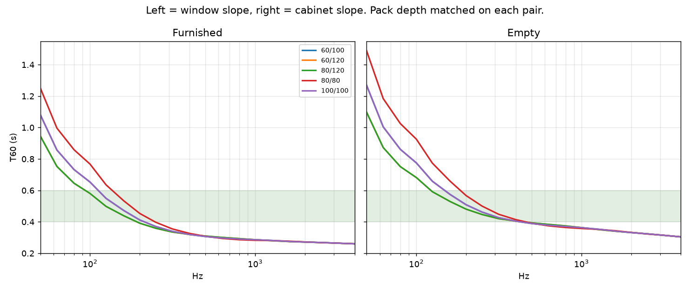
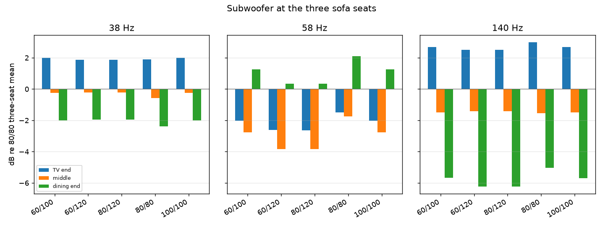

# Asymmetric slopes

Left is the window slope, from the eave up to the false ridge. Right is the cabinet slope, from the ridge down to the soffit. The subwoofer sits against that cabinet wall, at the TV gable. In the cross-section the window slope is on the left and the cabinet slope on the right.

120 mm is possible. The room-side pack is StoSilent, then NaturHeld, then mineral wool, stopped on the GKF. On a 120 mm side the mineral wool is zero: the pack is 120 mm of NaturHeld. The other side uses mineral wool (12 000 Pa·s/m²) so NaturHeld plus mineral wool is also 120 mm. Both ceilings drop together, 40 mm lower than the 80 mm drawing. The wool behind the GKF, in the hanger void, is not this layer and is unchanged. A pack capped at the drawn 80 mm could not hold 120 mm of NaturHeld.

For 60/100 the common pack is 100 mm (60 + 40 mm mineral wool, and 100 + 0). For 60/120 and 80/120 it is 120 mm. 80/80 and 100/100 are the last run: NaturHeld only, no mineral wool, both sides the same.

Window slope 33.5 m², cabinet slope 33.5 m², between the traps. Sofa, soffit wool and both traps stay as in the last run.

## Furnished T60

| Hz | 60/100 | 60/120 | 80/120 | 80/80 | 100/100 |
| --- | ---: | ---: | ---: | ---: | ---: |
| 50 | 1.08 | 0.95 | 0.95 | 1.25 | 1.08 |
| 63 | 0.86 | 0.75 | 0.75 | 1.00 | 0.86 |
| 80 | 0.73 | 0.65 | 0.65 | 0.86 | 0.73 |
| 100 | 0.65 | 0.58 | 0.58 | 0.77 | 0.65 |
| 125 | 0.55 | 0.50 | 0.50 | 0.64 | 0.55 |
| 160 | 0.47 | 0.44 | 0.44 | 0.53 | 0.47 |
| 200 | 0.41 | 0.39 | 0.39 | 0.45 | 0.41 |
| 250 | 0.37 | 0.36 | 0.36 | 0.40 | 0.37 |
| 315 | 0.34 | 0.33 | 0.34 | 0.35 | 0.34 |
| 400 | 0.32 | 0.32 | 0.32 | 0.33 | 0.32 |
| 500 | 0.31 | 0.31 | 0.31 | 0.31 | 0.31 |
| 630 | 0.30 | 0.30 | 0.30 | 0.29 | 0.30 |
| 800 | 0.29 | 0.29 | 0.29 | 0.29 | 0.29 |
| 1000 | 0.29 | 0.29 | 0.29 | 0.28 | 0.29 |
| 1250 | 0.28 | 0.28 | 0.28 | 0.28 | 0.28 |
| 1600 | 0.28 | 0.27 | 0.27 | 0.28 | 0.28 |
| 2000 | 0.27 | 0.27 | 0.27 | 0.27 | 0.27 |
| 2500 | 0.27 | 0.27 | 0.27 | 0.27 | 0.27 |
| 3150 | 0.26 | 0.26 | 0.26 | 0.26 | 0.26 |
| 4000 | 0.26 | 0.26 | 0.26 | 0.26 | 0.26 |

## Empty T60

| Hz | 60/100 | 60/120 | 80/120 | 80/80 | 100/100 |
| --- | ---: | ---: | ---: | ---: | ---: |
| 50 | 1.27 | 1.10 | 1.10 | 1.49 | 1.27 |
| 63 | 1.00 | 0.87 | 0.87 | 1.18 | 1.00 |
| 80 | 0.86 | 0.75 | 0.75 | 1.03 | 0.86 |
| 100 | 0.78 | 0.68 | 0.68 | 0.93 | 0.77 |
| 125 | 0.66 | 0.59 | 0.59 | 0.77 | 0.66 |
| 160 | 0.57 | 0.53 | 0.53 | 0.66 | 0.57 |
| 200 | 0.51 | 0.48 | 0.48 | 0.57 | 0.51 |
| 250 | 0.46 | 0.45 | 0.45 | 0.50 | 0.46 |
| 315 | 0.43 | 0.42 | 0.42 | 0.45 | 0.43 |
| 400 | 0.40 | 0.40 | 0.40 | 0.41 | 0.40 |
| 500 | 0.39 | 0.39 | 0.39 | 0.39 | 0.39 |
| 630 | 0.38 | 0.38 | 0.38 | 0.37 | 0.38 |
| 800 | 0.37 | 0.37 | 0.37 | 0.36 | 0.37 |
| 1000 | 0.36 | 0.36 | 0.36 | 0.36 | 0.36 |
| 1250 | 0.35 | 0.35 | 0.35 | 0.35 | 0.35 |
| 1600 | 0.34 | 0.34 | 0.34 | 0.34 | 0.34 |
| 2000 | 0.33 | 0.33 | 0.33 | 0.33 | 0.33 |
| 2500 | 0.32 | 0.32 | 0.32 | 0.32 | 0.32 |
| 3150 | 0.31 | 0.31 | 0.31 | 0.31 | 0.31 |
| 4000 | 0.30 | 0.30 | 0.30 | 0.30 | 0.30 |

## Bass average, 50–80 Hz

| Pair | Pack mm | Furnished s | Empty s |
| --- | ---: | ---: | ---: |
| 60/100 | 100 | 0.89 | 1.04 |
| 60/120 | 120 | 0.78 | 0.91 |
| 80/120 | 120 | 0.78 | 0.91 |
| 80/80 | 80 | 1.04 | 1.23 |
| 100/100 | 100 | 0.89 | 1.04 |

## Subwoofer seats

Decibels relative to the three-seat mean of 80/80 at the same frequency. Seats are TV end, middle, dining end.

| Pair | 38 Hz | 58 Hz | 140 Hz |
| --- | --- | --- | --- |
| 60/100 | +2.0, -0.2, -2.0 | -2.0, -2.8, +1.3 | +2.7, -1.5, -5.7 |
| 60/120 | +1.9, -0.2, -1.9 | -2.6, -3.8, +0.3 | +2.5, -1.4, -6.2 |
| 80/120 | +1.9, -0.2, -2.0 | -2.6, -3.8, +0.3 | +2.5, -1.4, -6.2 |
| 80/80 | +1.9, -0.6, -2.4 | -1.5, -1.7, +2.1 | +3.0, -1.5, -5.0 |
| 100/100 | +2.0, -0.2, -2.0 | -2.0, -2.8, +1.3 | +2.7, -1.5, -5.7 |
| 100/60, swapped | +2.0, -0.2, -2.0 | -2.0, -2.8, +1.3 | +2.7, -1.5, -5.7 |

## What each one does

60/100: pack 100 mm, window slope 60 mm NaturHeld plus 40 mm mineral wool, cabinet slope 100 mm NaturHeld plus 0 mm mineral wool. Furnished bass 0.89 s, against 80/80 -0.15 s and against 100/100 -0.00 s. Mids 0.30 s.

60/120: pack 120 mm, window slope 60 mm NaturHeld plus 60 mm mineral wool, cabinet slope 120 mm NaturHeld plus 0 mm mineral wool. Furnished bass 0.78 s, against 80/80 -0.25 s and against 100/100 -0.11 s. Mids 0.30 s.

80/120: pack 120 mm, window slope 80 mm NaturHeld plus 40 mm mineral wool, cabinet slope 120 mm NaturHeld plus 0 mm mineral wool. Furnished bass 0.78 s, against 80/80 -0.25 s and against 100/100 -0.11 s. Mids 0.30 s.

80/80 is the drawing. Furnished bass 1.04 s, mids 0.30 s. Same dry mids as the last run, bass still about three times longer.

100/100 is the previous recommendation. Furnished bass 0.89 s (-0.15 s against 80/80), mids 0.30 s. The mids do not move.

Swapping 60 and 100, so the thicker NaturHeld is on the window and away from the sub, moves the seat levels by at most 0.0 dB at 38, 58 and 140 Hz. One-sided absorption does not matter at these notes. The sub is in the corner, but the two slopes are large faces over the whole length, and 60 against 100 is not a big enough contrast for the seats to notice which side is which.

The two slopes are the same area, so the decay cannot see which side is thicker, and the seat levels cannot hear it either. What changes the bass is the pack depth. 60 mm of NaturHeld plus 40 mm of mineral wool matches 100 mm of NaturHeld at every third octave, so 60/100 is the same room as 100/100. A 120 mm pack matches itself whichever way the board and the wool are split, so 60/120 and 80/120 are the same room: furnished bass 0.78 s, 0.11 s shorter than 100/100. The mids stay at 0.30 s. The 120 mm pack is the shortest bass here. It still leaves the bass more than twice the mids, and it drops both ceilings 40 mm below the 80 mm drawing.

