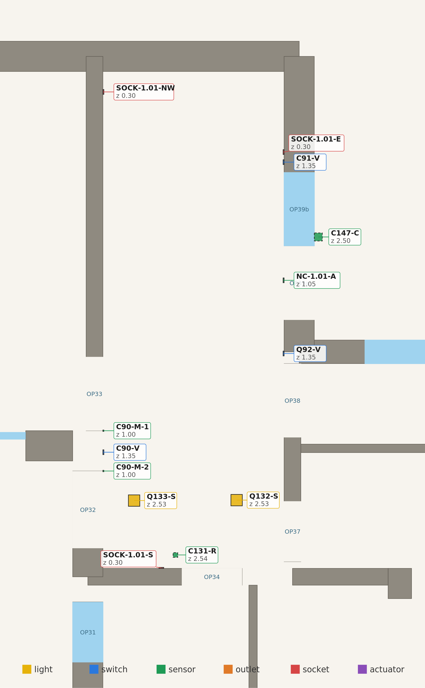

# 1.01 Zádveří: field devices

Source of truth: [`inputs/ground_floor/electrical-1.01.yaml`](../../../inputs/ground_floor/electrical-1.01.yaml). This page is generated from it by `python models/electrical_rooms_plan.py`; edit the YAML, not this page.

Sources: FixturePlan.pdf (Petr's marks on the floor plan) for positions, CableSchedule.xlsx sheet Soupis for cables. House rules: [PlanNotes.md](../PlanNotes.md). Naming: [Rooms.md](../Rooms.md). All open questions: [Questions.md](../Questions.md).

| Id | Cable | Code | Type | x | y | z (centre) | Notes |
| --- | --- | --- | --- | --- | --- | --- | --- |
| `Q133-S` | ? (plan 133) | S | Downlight | 30.62 | 9.21 | 2.53 | Plan mark 2(133). Plan symbol LP 170R. |
| `Q132-S` | ? (plan 132) | S | Downlight | 32.14 | 9.22 | 2.53 | Plan mark 2(132). Plan symbol LP 170R. |
| `C90-V` | 90 | V | PushButton | 30.16 | 9.93 | 1.35 | Plan mark 1(090). West wall pier between OP32 and OP33, at the plan dot. The model has no wall on that pier (y 9.65–10.25), so the box floats there in the model. Controls: Q133-S, Q132-S. |
| `C91-V` | 91 | V | PushButton | 32.84 | 14.25 | 1.35 | Plan mark 1(091). Controls: Q133-S, Q132-S. |
| `Q92-V` | ? (plan 92) | V | PushButton | 32.84 | 11.40 | 1.35 | Plan mark 1(092). Controls: Q133-S, Q132-S. |
| `C90-M-1` | 90 | M | DoorContact | 30.16 | 10.25 | 1.00 | Plan mark 1(090). |
| `C90-M-2` | 90 | M | DoorContact | 30.16 | 9.65 | 1.00 | Plan mark 1(090). |
| `C131-R` | 131 | R | MmWavePresence | 31.23 | 8.40 | 2.54 | Plan mark 1(131). Drawn on the south wall; modelled on the ceiling next to it. |
| `C147-C` | 147 | C | Camera | 33.36 | 13.14 | 2.50 | Plan mark 1(147). Plan: "G6 Turret PoE venku před sklem" on the east facade. |
| `NC-1.01-A` |  | A | AliroReader | 32.84 | 12.49 | 1.05 | Key symbol in the entrance door OP39a, no cable mark (lock?). |
| `SOCK-1.01-S` |  |  | Socket | 31.02 | 8.21 | 0.30 |  |
| `SOCK-1.01-NW` |  |  | Socket | 30.16 | 15.30 | 0.30 |  |
| `SOCK-1.01-E` |  |  | Socket | 32.84 | 14.40 | 0.30 | Under C91-V. |

## Open questions

- `Q133-S`: 1.01 lights are marked 2(132) and 2(133). Soupis 132 is the 1.20 V,M,R cable and 133 the 1.08 gutter; Soupis has no light row for 1.01. Which cables?
- `Q92-V`: Button by the 1.01→1.17 door is marked 1(092); Soupis 92 is the 1.14 blind. Which cable?
- `NC-1.01-A`: Key symbols at the entrance (OP39a), the 1.01→1.17 door and the garzonka door have no cable. Door locks fed from the Aliro boxes? Remove them if not fixtures.
