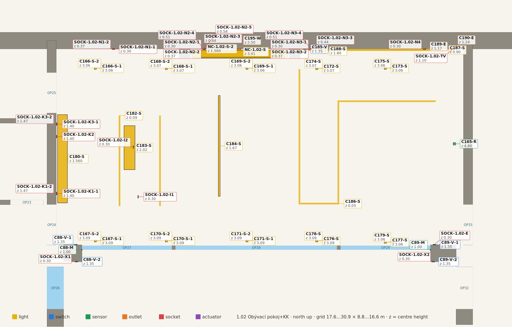

# 1.02 Obývací pokoj+KK: field devices

Source of truth: [`inputs/ground_floor/electrical-1.02.yaml`](../../../inputs/ground_floor/electrical-1.02.yaml). This page is generated from it by `python models/electrical_rooms_plan.py`; edit the YAML, not this page.

Sources: FixturePlan.pdf (Petr's marks on the floor plan) for positions, CableSchedule.xlsx sheet Soupis for cables. House rules: [PlanNotes.md](../PlanNotes.md). Naming: [Rooms.md](../Rooms.md). All open questions: [Questions.md](../Questions.md).

| Id | Cable | Code | Type | x | y | z (centre) | Notes |
| --- | --- | --- | --- | --- | --- | --- | --- |
| `C166-S-1` | 166 | S | Downlight | 19.86 | 15.07 | 3.06 | Plan mark 2(166). Plan symbol D55. One cable feeds the pair of D55 spots. |
| `C166-S-2` | 166 | S | Downlight | 20.09 | 15.07 | 3.06 | Plan mark 2(166). Plan symbol D55. One cable feeds the pair of D55 spots. |
| `C167-S-1` | 167 | S | Downlight | 19.86 | 10.36 | 3.09 | Plan mark 2(167). Plan symbol D55. One cable feeds the pair of D55 spots. |
| `C167-S-2` | 167 | S | Downlight | 20.09 | 10.36 | 3.09 | Plan mark 2(167). Plan symbol D55. One cable feeds the pair of D55 spots. |
| `C168-S-1` | 168 | S | Downlight | 21.80 | 15.06 | 3.07 | Plan mark 3(168). Plan symbol D55. One cable feeds the pair of D55 spots. |
| `C168-S-2` | 168 | S | Downlight | 22.03 | 15.06 | 3.07 | Plan mark 3(168). Plan symbol D55. One cable feeds the pair of D55 spots. |
| `C170-S-1` | 170 | S | Downlight | 21.80 | 10.36 | 3.09 | Plan mark 3(170). Plan symbol D55. One cable feeds the pair of D55 spots. |
| `C170-S-2` | 170 | S | Downlight | 22.03 | 10.36 | 3.09 | Plan mark 3(170). Plan symbol D55. One cable feeds the pair of D55 spots. |
| `C169-S-1` | 169 | S | Downlight | 24.00 | 15.07 | 3.06 | Plan mark 3(169). Plan symbol D55. One cable feeds the pair of D55 spots. |
| `C169-S-2` | 169 | S | Downlight | 24.23 | 15.07 | 3.06 | Plan mark 3(169). Plan symbol D55. One cable feeds the pair of D55 spots. |
| `C171-S-1` | 171 | S | Downlight | 24.00 | 10.36 | 3.09 | Plan mark 3(171). Plan symbol D55. One cable feeds the pair of D55 spots. |
| `C171-S-2` | 171 | S | Downlight | 24.23 | 10.36 | 3.09 | Plan mark 3(171). Plan symbol D55. One cable feeds the pair of D55 spots. |
| `C172-S` | 172 | S | Downlight | 25.90 | 15.06 | 3.07 | Plan mark 2(172). Plan symbol D55. Pair marked with two cables; left spot = lower number (assumption). |
| `C174-S` | 174 | S | Downlight | 26.13 | 15.06 | 3.07 | Plan mark 2(174). Plan symbol D55. Pair marked with two cables; left spot = lower number (assumption). |
| `C176-S` | 176 | S | Downlight | 25.90 | 10.36 | 3.09 | Plan mark 2(176). Plan symbol D55. Pair marked with two cables; left spot = lower number (assumption). |
| `C178-S` | 178 | S | Downlight | 26.13 | 10.36 | 3.09 | Plan mark 2(178). Plan symbol D55. Pair marked with two cables; left spot = lower number (assumption). |
| `C173-S` | 173 | S | Downlight | 27.77 | 15.07 | 3.06 | Plan mark 2(173). Plan symbol D55. Pair marked with two cables; left spot = lower number (assumption). |
| `C175-S` | 175 | S | Downlight | 28.00 | 15.07 | 3.06 | Plan mark 2(175). Plan symbol D55. Pair marked with two cables; left spot = lower number (assumption). |
| `C177-S` | 177 | S | Downlight | 27.77 | 10.32 | 3.06 | Plan mark 2(177). Plan symbol D55. Pair marked with two cables; left spot = lower number (assumption). |
| `C179-S` | 179 | S | Downlight | 28.00 | 10.32 | 3.06 | Plan mark 2(179). Plan symbol D55. Pair marked with two cables; left spot = lower number (assumption). |
| `C180-S` | 180 | S | LedPanel | panels (1) |  | 1.560 | Plan mark 3(180). Plan: "Panel 250x2400 (~200 W)", drawn over the west wall cabinets: the LED panel in the underside of KR-WEST-H (SF-CH850, SF-BH800, SF-AH850), one continuous field behind one 3 mm opal diffuser, flush at 1560 (Petr, PR #138: “a single panel even accross where the cabinets meet”). Until 2026-11-22 c a ceiling panel at 3.92. No box; the viewer draws the diffuser from PanelRun (the kitchen model's LED field). See kitchen-cabinets.md, LED panels under the wall cabinets. |
| `C181-S` | 181 | S | LedStrip | — |  |  | Plan mark 2(181). The plan's strip line about 260 in front of the west wall cabinets (the worktop front edge); #120 put it at 1.530, under the cabinets. Not the under-cabinet panel (that is C180-S, 2026-11-22 c). Soupis: into a box in the pre-wall, position after the sliding-door work. Unplaced since 2026-11-22 d: #120's strip at 1.530 hung in the air in front of the wall cabinets. No position; no body. |
| `C182-S` | 182 | S | LedStrip | path |  |  | Plan mark 2(182). Island strips on both long sides; Soupis: from a floor box. In the toe-kick, just under the carcass bottom behind the fronts (z 0.088–0.100), guess:. No box; the viewer draws the legs from Path (x,y,z points; \| separates runs). |
| `C183-S` | 183 | S | Panel | 20.80 | 12.90 | 2.02 | Plan mark 3(183). Plan symbol Panel 300x1200. In the steel shelf above the hood (Soupis); shelf height not known, 2.00 m used. |
| `C184-S` | 184 | S | Pendant | 23.24 | 12.95 | 1.67 | Plan mark 3(184). Plan symbol Bar 2xL900. Suspended bar with 2x L900 (60 W) over the dining table; bottom 1.65 m assumed. |
| `C186-S` | 186 | S | LedStrip | path |  |  | Plan mark 3(186). No box; the viewer draws the legs from Path (x,y,z points; \| separates runs). |
| `C187-S` | 187 | S | LedStrip | path |  |  | Plan mark 3(187). Three shelf strips on the north wall (drawn as three lines); shelf heights 0.90/1.30/1.70 assumed. No box; the viewer draws the legs from Path (x,y,z points; \| separates runs). |
| `C188-S` | 188 | S | Lamp | 26.09 | 15.54 | 1.80 | Plan mark 2(188). Plan symbol Out-door. Wall lamp on the north wall; height 1.80 assumed. |
| `NC-1.02-S` |  | S | Panel | 23.77 | 15.44 | 3.01 | Plan symbol Panel 200x2500. Plan: "Panel 200x2500 (~160 W)" along the north wall, no cable mark. |
| `NC-1.02-S-2` |  | S | LedPanel | panels (1) |  | 1.560 | Not on the plan (added 2026-11-22 a). LED panels in the underside of the dining wall cabinet SF-DH (KR-DH), one continuous field behind one 3 mm opal diffuser, flush at 1560. **MISSING CABLE: not in the Soupis, it was forgotten; to be added on site.** Temporary cable name TEMP-1.02-DH; panel, spec and route are guesses. No box; the viewer draws the diffusers from PanelRun. See kitchen-cabinets.md, LED panels under the wall cabinets. |
| `C185-V` | 185 | V | PushButton | 25.58 | 15.59 | 1.35 | Plan mark 1(185). Deep box; 186–188 end here (Soupis). Controls: C166-S-1, C166-S-2, C167-S-1, C167-S-2, C168-S-1, C168-S-2, C170-S-1, C170-S-2, C169-S-1, C169-S-2, C171-S-1, C171-S-2, C172-S, C174-S, C176-S, C178-S, C173-S, C175-S, C177-S, C179-S, C180-S, C181-S, C182-S, C183-S, C184-S, C186-S, C187-S, C188-S, NC-1.02-S, NC-1.02-S-2. |
| `C88-V-1` | 88 | V | PushButton | 19.34 | 10.26 | 1.35 | Plan mark 1(088). Controls: C166-S-1, C166-S-2, C167-S-1, C167-S-2, C168-S-1, C168-S-2, C170-S-1, C170-S-2, C169-S-1, C169-S-2, C171-S-1, C171-S-2, C172-S, C174-S, C176-S, C178-S, C173-S, C175-S, C177-S, C179-S, C180-S, C181-S, C182-S, C183-S, C184-S, C186-S, C187-S, C188-S, NC-1.02-S, NC-1.02-S-2. |
| `C88-V-2` | 88 | V | PushButton | 19.35 | 9.79 | 1.35 | Plan mark 1(088). Terrace side. |
| `C89-V-1` | 89 | V | PushButton | 29.11 | 10.26 | 1.35 | Plan mark 1(089). Controls: C166-S-1, C166-S-2, C167-S-1, C167-S-2, C168-S-1, C168-S-2, C170-S-1, C170-S-2, C169-S-1, C169-S-2, C171-S-1, C171-S-2, C172-S, C174-S, C176-S, C178-S, C173-S, C175-S, C177-S, C179-S, C180-S, C181-S, C182-S, C183-S, C184-S, C186-S, C187-S, C188-S, NC-1.02-S, NC-1.02-S-2. |
| `C89-V-2` | 89 | V | PushButton | 29.07 | 9.79 | 1.35 | Plan mark 1(089). Terrace side. |
| `C200-V` | 200 | V | PushButton | — |  |  | Soupis row added 3.4.2026, after the plan; no position. No position on the plan; no body. Controls: C166-S-1, C166-S-2, C167-S-1, C167-S-2, C168-S-1, C168-S-2, C170-S-1, C170-S-2, C169-S-1, C169-S-2, C171-S-1, C171-S-2, C172-S, C174-S, C176-S, C178-S, C173-S, C175-S, C177-S, C179-S, C180-S, C181-S, C182-S, C183-S, C184-S, C186-S, C187-S, C188-S, NC-1.02-S, NC-1.02-S-2. |
| `C165-R` | 165 | R | MmWavePresence | 29.65 | 13.01 | 4.80 | Plan mark 1(165). |
| `C88-M` | 88 | M | WindowContact | 19.50 | 10.12 | 1.00 | Plan mark 1(088). |
| `C89-M` | 89 | M | WindowContact | 29.00 | 10.12 | 1.00 | Plan mark 1(089). |
| `C189-E` | 189 | E | Ethernet | 29.60 | 15.59 | 1.17 | Plan mark 1(189). TV corner: plan note "2x Ethernet a 230V zásuvka pro AppleTV a TV ... výška cca 110, potvrdím". |
| `C190-E` | 190 | E | Ethernet | 29.60 | 15.59 | 1.24 | Plan mark 1(190). TV corner: plan note "2x Ethernet a 230V zásuvka pro AppleTV a TV ... výška cca 110, potvrdím". |
| `SOCK-1.02-TV` |  |  | Socket | 29.60 | 15.59 | 1.10 | TV corner socket, 1100 (plan note, to be confirmed). |
| `C195-W` | 195 | W | WifiAccessPoint | 23.75 | 15.58 | 2.50 | Plan mark (none). Plan: "U7 Pro Wall na SDK ve výšce 2.5 m". |
| `C201-E` | 201 | E | Ethernet | — |  |  | Soupis row added 3.4.2026, after the plan; no position. No position on the plan; no body. |
| `SOCK-1.02-N1-1` |  |  | Socket | 20.36 | 15.59 | 0.30 | Plan: "Na lednici a mikrovlnku". |
| `SOCK-1.02-N1-2` |  |  | Socket | 20.36 | 15.59 | 0.37 | Plan: "Na lednici a mikrovlnku". |
| `SOCK-1.02-N2-1` |  |  | Socket | 22.83 | 15.59 | 0.30 |  |
| `SOCK-1.02-N2-2` |  |  | Socket | 22.83 | 15.59 | 0.37 |  |
| `SOCK-1.02-N2-3` |  |  | Socket | 22.83 | 15.59 | 0.44 |  |
| `SOCK-1.02-N2-4` |  |  | Socket | 22.83 | 15.59 | 0.51 |  |
| `SOCK-1.02-N2-5` |  |  | Socket | 22.83 | 15.59 | 0.58 |  |
| `SOCK-1.02-N3-1` |  |  | Socket | 25.75 | 15.59 | 0.30 |  |
| `SOCK-1.02-N3-2` |  |  | Socket | 25.75 | 15.59 | 0.37 |  |
| `SOCK-1.02-N3-3` |  |  | Socket | 25.75 | 15.59 | 0.44 |  |
| `SOCK-1.02-N3-4` |  |  | Socket | 25.75 | 15.59 | 0.51 |  |
| `SOCK-1.02-N4` |  |  | Socket | 28.84 | 15.59 | 0.30 |  |
| `SOCK-1.02-K1-1` |  |  | Socket | 18.81 | 11.65 | 1.40 |  |
| `SOCK-1.02-K1-2` |  |  | Socket | 18.81 | 11.65 | 1.47 |  |
| `SOCK-1.02-K2` |  |  | Socket | 18.81 | 13.21 | 1.40 |  |
| `SOCK-1.02-K3-1` |  |  | Socket | 18.81 | 13.55 | 1.40 |  |
| `SOCK-1.02-K3-2` |  |  | Socket | 18.81 | 13.55 | 1.47 |  |
| `SOCK-1.02-I1` |  |  | Socket | 21.03 | 11.56 | 0.30 | Kitchen island; plan note: socket positions in the island to follow. |
| `SOCK-1.02-I2` |  |  | Socket | 20.90 | 12.92 | 0.30 | Kitchen island; plan note: socket positions in the island to follow. |
| `SOCK-1.02-E` |  |  | Socket | 29.11 | 10.26 | 0.30 |  |
| `SOCK-1.02-X1` |  |  | Socket | 19.35 | 9.79 | 0.30 |  |
| `SOCK-1.02-X2` |  |  | Socket | 29.08 | 9.79 | 0.30 |  |

## Open questions

- `C181-S`: Cable 181: the plan's thin strip line about 260 in front of the west wall cabinets (the worktop's front edge). Now that the under-cabinet panel is cable 180, what is 181: a strip at the worktop front, a plinth strip like 182, or spare? Unplaced: #120's strip at 1.530 floated 275 in front of the wall cabinets.
- `C182-S`: C182 island strips: plinth (0.10 m) or under the worktop overhang?
- `C183-S`: C183 panel in the shelf over the hood: what height is the shelf?
- `C186-S`: C186 strip follows a drawn outline from the north wall round to x 29.1 (sofa?). Floor level assumed.
- `NC-1.02-S`: 1.02 "Panel 200x2500" by the north wall has no cable mark. Which cable? Is it the same light as NC-1.02-S-2 (the LED panels under SF-DH, 2026-11-22 a), which it overlaps in plan?
- `NC-1.02-S-2`: TEMP-1.02-DH, the LED panel under SF-DH, has no cable: it was forgotten and must be pulled on site. Guess: CYKY 4x2.5 like C180 (24 V, about the same 2.6 m panel, ~8 A), from panel 1 (or from the deep box behind C185-V where 186-188 end) to the Ø10 hole in the SF-DH bottom at x 23.800, y 15.544. Give it a Soupis number.
