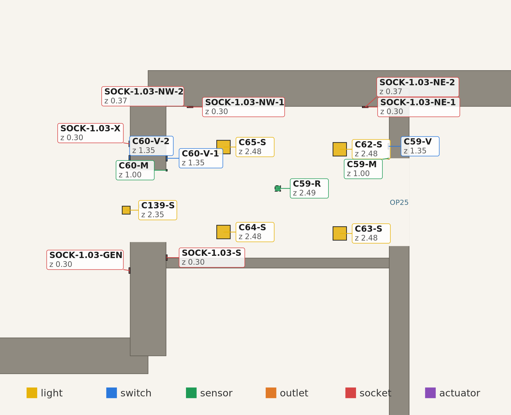

# 1.03 Spíž: field devices

Source of truth: [`inputs/ground_floor/electrical-1.03.yaml`](../../../inputs/ground_floor/electrical-1.03.yaml). This page is generated from it by `python models/electrical_rooms_plan.py`; edit the YAML, not this page.

Sources: FixturePlan.pdf (Petr's marks on the floor plan) for positions, CableSchedule.xlsx sheet Soupis for cables. House rules: [PlanNotes.md](../PlanNotes.md). Naming: [Rooms.md](../Rooms.md). All open questions: [Questions.md](../Questions.md).

| Id | Cable | Code | Type | x | y | z (centre) | Notes |
| --- | --- | --- | --- | --- | --- | --- | --- |
| `C62-S` | 62 | S | Downlight | 17.93 | 15.06 | 2.48 | Plan mark 2(062). Plan symbol PLP 170R. |
| `C63-S` | 63 | S | Downlight | 17.93 | 14.01 | 2.48 | Plan mark 2(063). Plan symbol PLP 170R. |
| `C64-S` | 64 | S | Downlight | 16.47 | 14.03 | 2.48 | Plan mark 2(064). Plan symbol PLP 170R. |
| `C65-S` | 65 | S | Downlight | 16.47 | 15.09 | 2.48 | Plan mark 2(065). Plan symbol PLP 170R. |
| `C139-S` | 139 | S | OutdoorLamp | 15.25 | 14.30 | 2.35 | Plan mark 5(139). Plan symbol Out-door. West facade above the pantry door OP20. |
| `C59-V` | 59 | V | PushButton | 18.54 | 15.10 | 1.35 | Plan mark 1(059). Controls: C62-S, C63-S, C64-S, C65-S. |
| `C60-V-1` | 60 | V | PushButton | 15.76 | 14.95 | 1.35 | Plan mark 1(060). Controls: C62-S, C63-S, C64-S, C65-S. |
| `C60-V-2` | 60 | V | PushButton | 15.29 | 14.95 | 1.35 | Plan mark 1(060). Outside button by the pantry door OP20. Controls: C139-S. |
| `C59-M` | 59 | M | DoorContact | 18.54 | 14.95 | 1.00 | Plan mark 1(059). |
| `C59-R` | 59 | R | MmWavePresence | 17.15 | 14.57 | 2.49 | Plan mark 1(061). |
| `C60-M` | 60 | M | DoorContact | 15.76 | 14.80 | 1.00 | Plan mark 1(060). |
| `SOCK-1.03-NW-1` |  |  | Socket | 16.05 | 15.59 | 0.30 |  |
| `SOCK-1.03-NW-2` |  |  | Socket | 16.05 | 15.59 | 0.37 |  |
| `SOCK-1.03-NE-1` |  |  | Socket | 18.25 | 15.59 | 0.30 |  |
| `SOCK-1.03-NE-2` |  |  | Socket | 18.25 | 15.59 | 0.37 |  |
| `SOCK-1.03-S` |  |  | Socket | 15.76 | 13.71 | 0.30 |  |
| `SOCK-1.03-X` |  |  | Socket | 15.29 | 15.13 | 0.30 |  |
| `SOCK-1.03-GEN` |  |  | Socket | 15.29 | 13.54 | 0.30 | Plan: "Generator" — 3-phase generator inlet (note: any 3-phase generator, switch here or in the tech room to island the house). |

## Open questions

- `C59-R`: Pantry radar is marked 1(061); Soupis 61 is the 1.12 blind and the R is on cable 59 (V,M,R). Modelled as C59-R on the ceiling.
