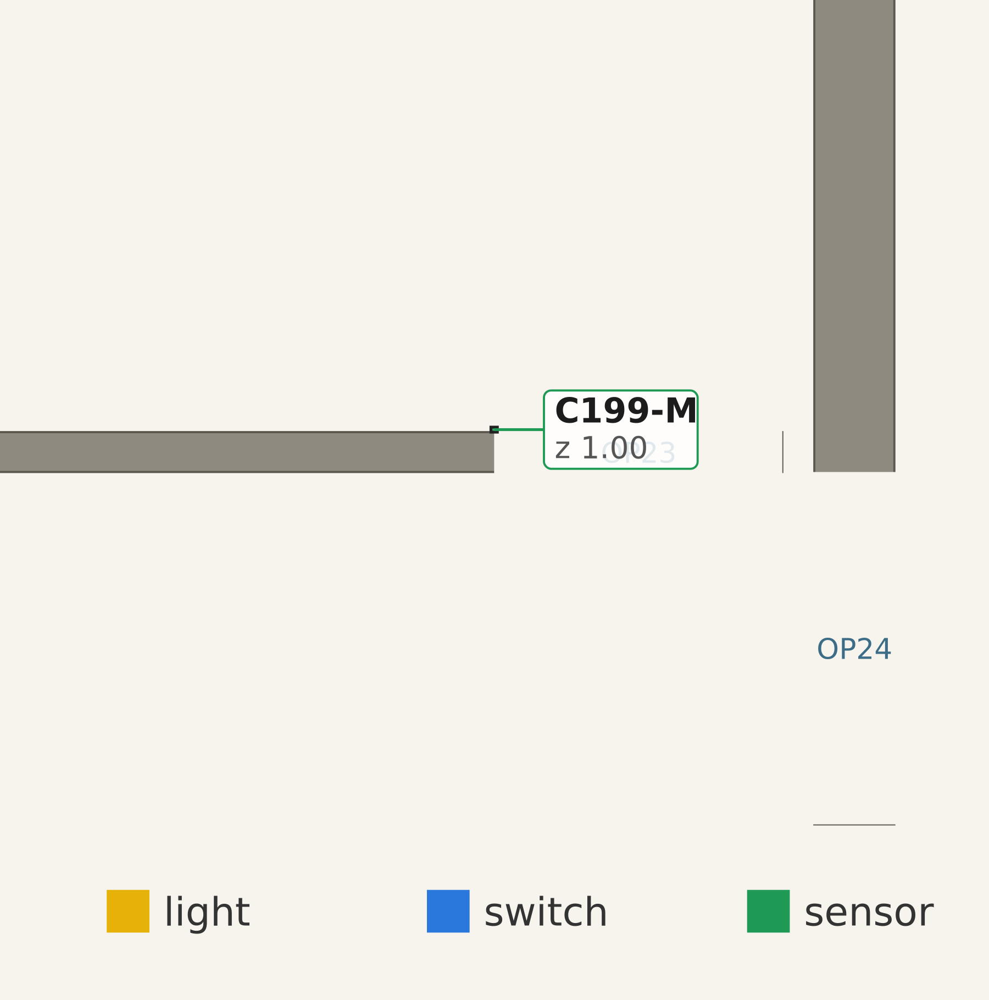

# 1.04 Technická místnost: field devices

Source of truth: [`inputs/ground_floor/electrical-1.04.yaml`](../../../inputs/ground_floor/electrical-1.04.yaml). This page is generated from it by `python models/electrical_rooms_plan.py`; edit the YAML, not this page.

Sources: FixturePlan.pdf (Petr's marks on the floor plan) for positions, CableSchedule.xlsx sheet Soupis for cables. House rules: [PlanNotes.md](../PlanNotes.md). Naming: [Rooms.md](../Rooms.md). All open questions: [Questions.md](../Questions.md).

| Id | Cable | Code | Type | x | y | z (centre) | Notes |
| --- | --- | --- | --- | --- | --- | --- | --- |
| `C191-S` | 191 | S | LedStrip | — |  |  | Future pergola lighting (Soupis note): a thick conduit for 4 cables. No position until the pergola exists. No position on the plan; no body. |
| `C192-S` | 192 | S | LedStrip | — |  |  | Future pergola lighting (Soupis note): a thick conduit for 4 cables. No position until the pergola exists. No position on the plan; no body. |
| `C193-S` | 193 | S | LedStrip | — |  |  | Future pergola lighting (Soupis note): a thick conduit for 4 cables. No position until the pergola exists. No position on the plan; no body. |
| `C194-S` | 194 | S | LedStrip | — |  |  | Future pergola lighting (Soupis note): a thick conduit for 4 cables. No position until the pergola exists. No position on the plan; no body. |
| `C199-M` | 199 | M | DoorContact | 17.55 | 11.48 | 1.00 | Plan mark (none). Soupis row added for the OP23 door; plan dot at the door. |

## Open questions

None for this room.
