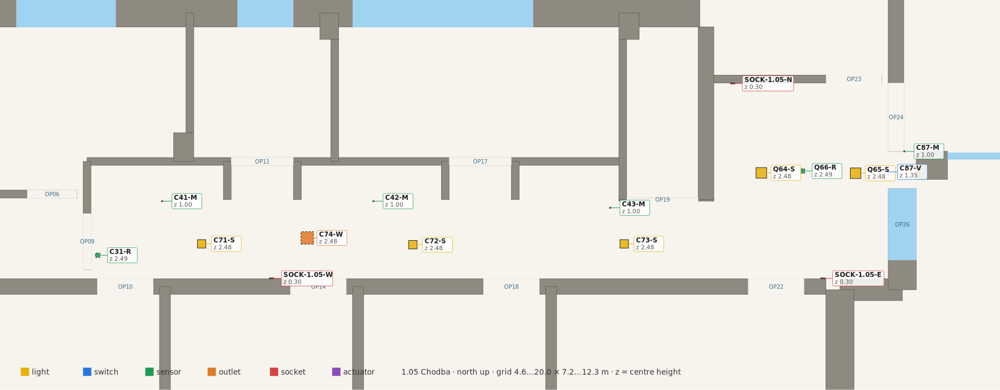

# 1.05 Chodba: field devices

Source of truth: [`inputs/ground_floor/electrical-1.05.yaml`](../../../inputs/ground_floor/electrical-1.05.yaml). This page is generated from it by `python models/electrical_rooms_plan.py`; edit the YAML, not this page.

Sources: FixturePlan.pdf (Petr's marks on the floor plan) for positions, CableSchedule.xlsx sheet Soupis for cables. House rules: [PlanNotes.md](../PlanNotes.md). Naming: [Rooms.md](../Rooms.md). All open questions: [Questions.md](../Questions.md).

| Id | Cable | Code | Type | x | y | z (centre) | Notes |
| --- | --- | --- | --- | --- | --- | --- | --- |
| `C71-S` | 71 | S | Downlight | 7.53 | 8.76 | 2.48 | Plan mark 2(071). Plan symbol D135. Plan note: own bracket, not the original holder. |
| `C72-S` | 72 | S | Downlight | 10.92 | 8.75 | 2.48 | Plan mark 2(072). Plan symbol D135. Plan note: own bracket, not the original holder. |
| `C73-S` | 73 | S | Downlight | 14.31 | 8.76 | 2.48 | Plan mark 2(073). Plan symbol D135. Plan note: own bracket, not the original holder. |
| `Q64-S` | ? (plan 64) | S | Downlight | 16.51 | 9.90 | 2.48 | Plan mark 2(064). Plan symbol LP 170R. |
| `Q65-S` | ? (plan 65) | S | Downlight | 18.03 | 9.90 | 2.48 | Plan mark 2(065). Plan symbol LP 170R. |
| `C87-V` | 87 | V | PushButton | 18.54 | 9.92 | 1.35 | Plan mark 1(087). At the plan dot. The model has no wall between W-051 (ends y 9.65) and the OP24 jamb (y 10.25), so the box floats there in the model. Controls: C71-S, C72-S, C73-S, Q64-S, Q65-S. |
| `C31-R` | 31 | R | MmWavePresence | 5.86 | 8.58 | 2.49 | Plan mark 1(031). |
| `C41-M` | 41 | M | DoorContact | 6.89 | 9.45 | 1.00 | Plan mark 1(041). Soupis: "později do nábytku" (later into the built-in wardrobe). Placed on the wardrobe front line at the plan dot. |
| `C42-M` | 42 | M | DoorContact | 10.28 | 9.45 | 1.00 | Plan mark 1(042). Soupis: "později do nábytku" (later into the built-in wardrobe). Placed on the wardrobe front line at the plan dot. |
| `C43-M` | 43 | M | DoorContact | 14.09 | 9.34 | 1.00 | Plan mark 1(043). Soupis: "později do nábytku" (later into the built-in wardrobe). Placed on the wardrobe front line at the plan dot. |
| `C87-M` | 87 | M | DoorContact | 18.81 | 10.25 | 1.00 | Plan mark 1(087). |
| `Q66-R` | ? (plan 66) | R | MmWavePresence | 17.17 | 9.93 | 2.49 | Plan mark 1(066). |
| `C74-W` | 74 | W | WifiAccessPoint | 9.22 | 8.86 | 2.48 | Plan mark 1(074). |
| `SOCK-1.05-W` |  |  | Socket | 8.65 | 8.21 | 0.30 |  |
| `SOCK-1.05-E` |  |  | Socket | 17.50 | 8.21 | 0.30 |  |
| `SOCK-1.05-N` |  |  | Socket | 16.05 | 11.34 | 0.30 |  |

## Open questions

- `Q64-S`: Corridor-east lights marked 2(064) and 2(065): Soupis 64 and 65 are 1.03 pantry lights (also marked 2(064)/2(065) there). Which cables feed these two?
- `Q66-R`: Corridor-east radar marked 1(066): Soupis 66 is the 1.13 blind (marked 4(66) there). Which cable?
