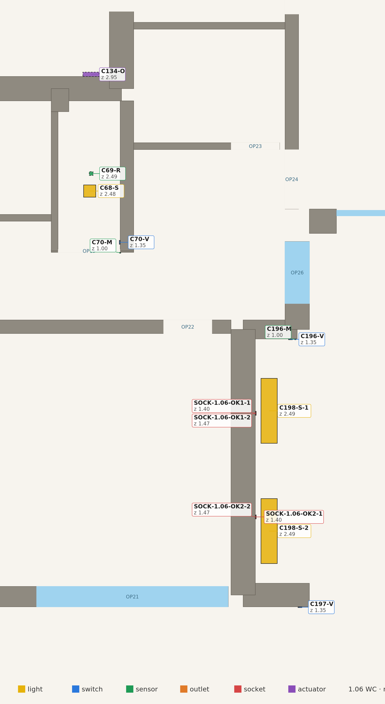

# 1.06 WC: field devices

Source of truth: [`inputs/ground_floor/electrical-1.06.yaml`](../../../inputs/ground_floor/electrical-1.06.yaml). This page is generated from it by `python models/electrical_rooms_plan.py`; edit the YAML, not this page.

Sources: FixturePlan.pdf (Petr's marks on the floor plan) for positions, CableSchedule.xlsx sheet Soupis for cables. House rules: [PlanNotes.md](../PlanNotes.md). Naming: [Rooms.md](../Rooms.md). All open questions: [Questions.md](../Questions.md).

| Id | Cable | Code | Type | x | y | z (centre) | Notes |
| --- | --- | --- | --- | --- | --- | --- | --- |
| `C68-S` | 68 | S | Downlight | 14.94 | 10.58 | 2.48 | Plan mark 2(068). Plan symbol LP 225R. Plan text LP225R 18W. |
| `C198-S-1` | 198 | S | Panel | 18.26 | 6.52 | 2.49 | Plan mark 3(198). Plan symbol Panel 300x1200. Outdoor kitchen ceiling panel, plan "Panel 300x1200 (~100 W)". Ceiling height 2.50 assumed. |
| `C198-S-2` | 198 | S | Panel | 18.26 | 4.30 | 2.49 | Plan mark 3(198). Plan symbol Panel 300x1200. Outdoor kitchen ceiling panel, plan "Panel 300x1200 (~100 W)". Ceiling height 2.50 assumed. |
| `C70-V` | 70 | V | PushButton | 15.49 | 9.64 | 1.35 | Plan mark 1(070). West face of W-048 inside the WC, next to the OP19 latch. Controls: C68-S. |
| `C196-V` | 196 | V | PushButton | 18.65 | 7.84 | 1.35 | Plan mark 1(196). Outdoor kitchen, south face of W-012. The plan dot sits just past the wall end; moved 125 mm onto the wall. Controls: C198-S-1, C198-S-2. |
| `C197-V` | 197 | V | PushButton | 18.83 | 2.89 | 1.35 | Plan mark 1(197). South facade by the outdoor kitchen, 300 mm from the outer corner. Controls: C198-S-1, C198-S-2. |
| `C69-R` | 69 | R | MmWavePresence | 14.96 | 10.91 | 2.49 | Plan mark 1(069). |
| `C70-M` | 70 | M | DoorContact | 15.50 | 9.44 | 1.00 | Plan mark 1(070). |
| `C196-M` | 196 | M | DoorContact | 18.74 | 7.84 | 1.00 | Plan mark 1(196). |
| `SOCK-1.06-OK1-1` |  |  | Socket | 18.01 | 6.48 | 1.40 | Outdoor kitchen, east face of W-049 above the counter (1400 assumed). |
| `SOCK-1.06-OK1-2` |  |  | Socket | 18.01 | 6.48 | 1.47 | Outdoor kitchen, east face of W-049 above the counter (1400 assumed). |
| `SOCK-1.06-OK2-1` |  |  | Socket | 18.01 | 4.56 | 1.40 | Outdoor kitchen, east face of W-049 above the counter (1400 assumed). |
| `SOCK-1.06-OK2-2` |  |  | Socket | 18.01 | 4.56 | 1.47 | Outdoor kitchen, east face of W-049 above the counter (1400 assumed). |
| `C134-O` | 134 | O | GutterHeating | 14.96 | 12.74 | 2.95 | Plan mark 4(134). |

## Open questions

- `C198-S-1`: C198 outdoor-kitchen panels: Soupis room is 1.06 (WC), the panels are in the outdoor kitchen; ceiling height unknown (2.50 used).
- `C196-M`: C196-M contact in the outdoor kitchen (plan dot at the east corner, x 19.02, y 7.66): there is no door or window there. What does it sense?
