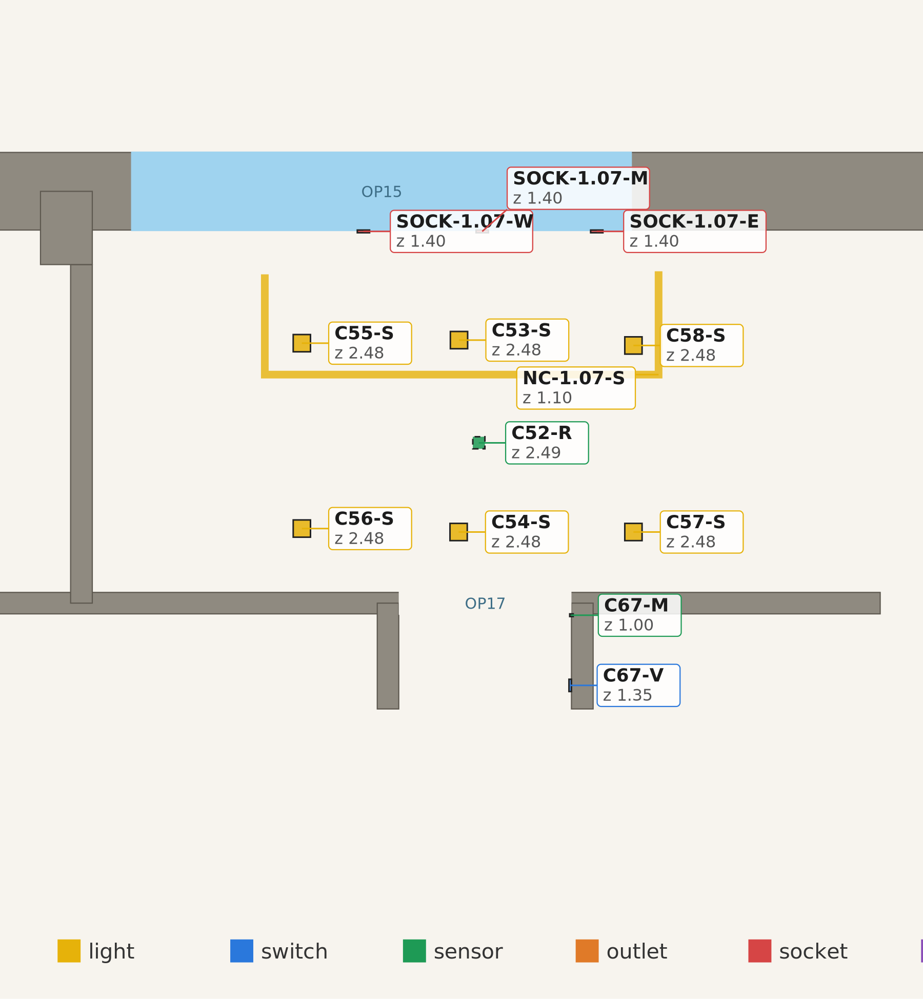

# 1.07 Koupelna: field devices

Source of truth: [`inputs/ground_floor/electrical-1.07.yaml`](../../../inputs/ground_floor/electrical-1.07.yaml). This page is generated from it by `python models/electrical_rooms_plan.py`; edit the YAML, not this page.

Sources: FixturePlan.pdf (Petr's marks on the floor plan) for positions, CableSchedule.xlsx sheet Soupis for cables. House rules: [PlanNotes.md](../PlanNotes.md). Naming: [Rooms.md](../Rooms.md). All open questions: [Questions.md](../Questions.md).

| Id | Cable | Code | Type | x | y | z (centre) | Notes |
| --- | --- | --- | --- | --- | --- | --- | --- |
| `C53-S` | 53 | S | Downlight | 11.85 | 11.61 | 2.48 | Plan mark 2(053). Plan symbol D100. |
| `C54-S` | 54 | S | Downlight | 11.85 | 10.50 | 2.48 | Plan mark 2(054). Plan symbol D100. |
| `C55-S` | 55 | S | Downlight | 10.94 | 11.59 | 2.48 | Plan mark 2(055). Plan symbol D100. |
| `C56-S` | 56 | S | Downlight | 10.94 | 10.52 | 2.48 | Plan mark 2(056). Plan symbol D100. |
| `C57-S` | 57 | S | Downlight | 12.86 | 10.50 | 2.48 | Plan mark 2(057). Plan symbol D100. |
| `C58-S` | 58 | S | Downlight | 12.86 | 11.58 | 2.48 | Plan mark 2(058). Plan symbol D100. |
| `NC-1.07-S` |  | S | LedStrip | path |  |  | Drawn U strip with a red note "LED pásek do přizdívky?" and "todo:". No cable mark. No box; the viewer draws the legs from Path (x,y,z points; \| separates runs). |
| `C67-V` | 67 | V | PushButton | 12.49 | 9.61 | 1.35 | Plan mark 1(067). In the door niche, west face of W-043 by the OP17 latch. Controls: C53-S, C54-S, C55-S, C56-S, C57-S, C58-S, NC-1.07-S. |
| `C52-R` | 52 | R | MmWavePresence | 11.96 | 11.02 | 2.49 | Plan mark 1(052). |
| `C67-M` | 67 | M | DoorContact | 12.50 | 10.02 | 1.00 | Plan mark 1(067). |
| `SOCK-1.07-W` |  |  | Socket | 11.30 | 12.24 | 1.40 | Plan note: all three sockets up above the plinth; middle one visible, two behind the mirrors. Height 1400 assumed. |
| `SOCK-1.07-M` |  |  | Socket | 11.98 | 12.24 | 1.40 | Plan note: all three sockets up above the plinth; middle one visible, two behind the mirrors. Height 1400 assumed. |
| `SOCK-1.07-E` |  |  | Socket | 12.65 | 12.24 | 1.40 | Plan note: all three sockets up above the plinth; middle one visible, two behind the mirrors. Height 1400 assumed. |

## Open questions

- `NC-1.07-S`: 1.07 U-shaped LED strip around the vanity pre-wall has no cable (red note "LED pásek do přizdívky? todo"). Is it wanted, and on which cable? Height 1.10 is a guess.
