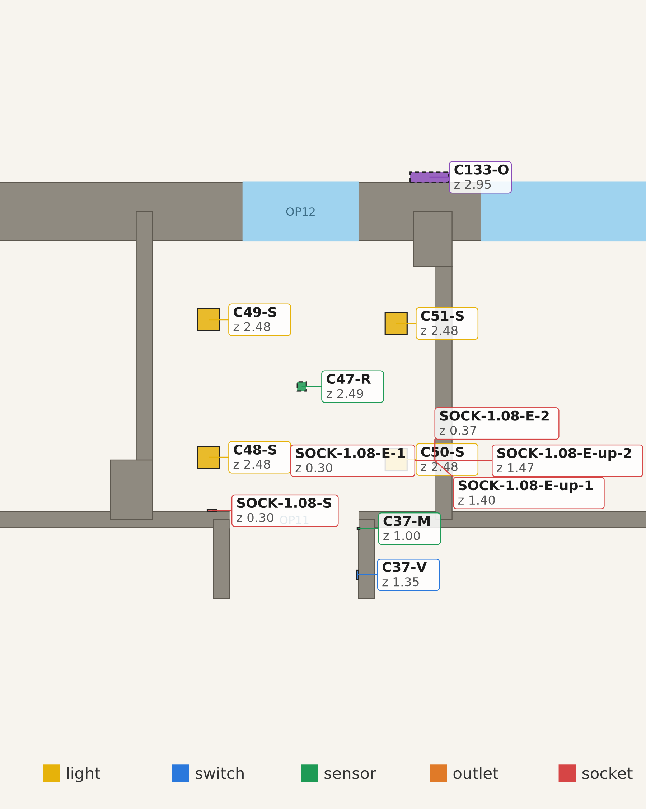

# 1.08 Prádelna: field devices

Source of truth: [`inputs/ground_floor/electrical-1.08.yaml`](../../../inputs/ground_floor/electrical-1.08.yaml). This page is generated from it by `python models/electrical_rooms_plan.py`; edit the YAML, not this page.

Sources: FixturePlan.pdf (Petr's marks on the floor plan) for positions, CableSchedule.xlsx sheet Soupis for cables. House rules: [PlanNotes.md](../PlanNotes.md). Naming: [Rooms.md](../Rooms.md). All open questions: [Questions.md](../Questions.md).

| Id | Cable | Code | Type | x | y | z (centre) | Notes |
| --- | --- | --- | --- | --- | --- | --- | --- |
| `C48-S` | 48 | S | Downlight | 7.84 | 10.57 | 2.48 | Plan mark 2(048). Plan symbol LP 170R. Surface-mounted (plan note "přisazená"). |
| `C49-S` | 49 | S | Downlight | 7.84 | 11.64 | 2.48 | Plan mark 2(049). Plan symbol LP 170R. Surface-mounted (plan note "přisazená"). |
| `C50-S` | 50 | S | Downlight | 9.29 | 10.55 | 2.48 | Plan mark 2(050). Plan symbol LP 170R. Surface-mounted (plan note "přisazená"). |
| `C51-S` | 51 | S | Downlight | 9.29 | 11.61 | 2.48 | Plan mark 2(051). Plan symbol LP 170R. Surface-mounted (plan note "přisazená"). |
| `C37-V` | 37 | V | PushButton | 8.99 | 9.66 | 1.35 | Plan mark 1(037). In the door niche, on the west face of W-038 next to the OP11 latch. Controls: C48-S, C49-S, C50-S, C51-S. |
| `C47-R` | 47 | R | MmWavePresence | 8.56 | 11.12 | 2.49 | Plan mark 1(047). |
| `C37-M` | 37 | M | DoorContact | 9.00 | 10.02 | 1.00 | Plan mark 1(037). |
| `SOCK-1.08-S` |  |  | Socket | 7.86 | 10.16 | 0.30 |  |
| `SOCK-1.08-E-1` |  |  | Socket | 9.59 | 10.54 | 0.30 | Plan: 4 sockets, "2 dole, 2 nahoře". Bottom pair 300/371. |
| `SOCK-1.08-E-2` |  |  | Socket | 9.59 | 10.54 | 0.37 | Plan: 4 sockets, "2 dole, 2 nahoře". Bottom pair 300/371. |
| `SOCK-1.08-E-up-1` |  |  | Socket | 9.59 | 10.54 | 1.40 | Plan: 4 sockets, "2 dole, 2 nahoře". Top pair 1400/1471. |
| `SOCK-1.08-E-up-2` |  |  | Socket | 9.59 | 10.54 | 1.47 | Plan: 4 sockets, "2 dole, 2 nahoře". Top pair 1400/1471. |
| `C133-O` | 133 | O | GutterHeating | 9.55 | 12.74 | 2.95 | Plan mark 4(133). |

## Open questions

None for this room.
