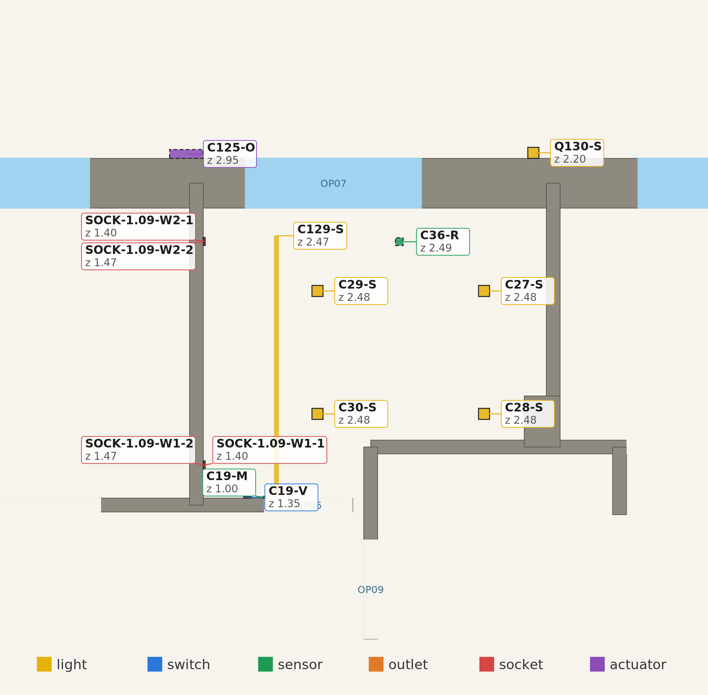

# 1.09 Koupelna: field devices

Source of truth: [`inputs/ground_floor/electrical-1.09.yaml`](../../../inputs/ground_floor/electrical-1.09.yaml). This page is generated from it by `python models/electrical_rooms_plan.py`; edit the YAML, not this page.

Sources: FixturePlan.pdf (Petr's marks on the floor plan) for positions, CableSchedule.xlsx sheet Soupis for cables. House rules: [PlanNotes.md](../PlanNotes.md). Naming: [Rooms.md](../Rooms.md). All open questions: [Questions.md](../Questions.md).

| Id | Cable | Code | Type | x | y | z (centre) | Notes |
| --- | --- | --- | --- | --- | --- | --- | --- |
| `C27-S` | 27 | S | Downlight | 6.71 | 11.50 | 2.48 | Plan mark 2(027). Plan symbol D100. |
| `C28-S` | 28 | S | Downlight | 6.71 | 10.39 | 2.48 | Plan mark 2(028). Plan symbol D100. |
| `C29-S` | 29 | S | Downlight | 5.21 | 11.50 | 2.48 | Plan mark 2(029). Plan symbol D100. |
| `C30-S` | 30 | S | Downlight | 5.21 | 10.39 | 2.48 | Plan mark 2(030). Plan symbol D100. |
| `C129-S` | 129 | S | LedStrip | path |  |  | Plan mark 2(129). No box; the viewer draws the legs from Path (x,y,z points; \| separates runs). |
| `Q130-S` | ? (plan 130) | S | OutdoorLamp | 7.16 | 12.75 | 2.20 | Plan mark 5(130). Plan symbol Out-door. |
| `C19-V` | 19 | V | PushButton | 4.58 | 9.63 | 1.35 | Plan mark 1(019). Inside 1.09, 150 mm west of the OP06 latch jamb. Controls: C27-S, C28-S, C29-S, C30-S, C129-S. |
| `C36-R` | 36 | R | MmWavePresence | 5.95 | 11.95 | 2.49 | Plan mark 1(036). |
| `C19-M` | 19 | M | DoorContact | 4.72 | 9.63 | 1.00 | Plan mark 1(019). |
| `SOCK-1.09-W1-1` |  |  | Socket | 4.18 | 9.93 | 1.40 | Basin wall, counter height 1400. Plan note: basin position not final. |
| `SOCK-1.09-W1-2` |  |  | Socket | 4.18 | 9.93 | 1.47 | Basin wall, counter height 1400. Plan note: basin position not final. |
| `SOCK-1.09-W2-1` |  |  | Socket | 4.18 | 11.95 | 1.40 | Basin wall, counter height 1400. Plan note: basin position not final. |
| `SOCK-1.09-W2-2` |  |  | Socket | 4.18 | 11.95 | 1.47 | Basin wall, counter height 1400. Plan note: basin position not final. |
| `C125-O` | 125 | O | GutterHeating | 4.02 | 12.74 | 2.95 | Plan mark 4(125). |

## Open questions

- `C129-S`: C129 strip along x 4.84 m (9.66 to 12.00): drawn as a line across 1.09. Modelled on the ceiling (2.47 m). Is it a ceiling cove, a mirror light, or in the pre-wall?
- `Q130-S`: North facade lamp above 1.08/1.09 is marked 5(130). Soupis 130 is the 1.23 blind (also marked 4(130) by 1.23). Which cable feeds this lamp?
