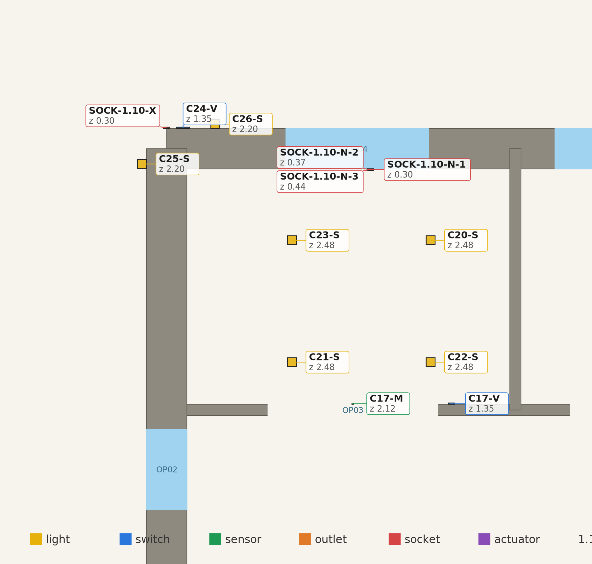

# 1.10 Šatna: field devices

Source of truth: [`inputs/ground_floor/electrical-1.10.yaml`](../../../inputs/ground_floor/electrical-1.10.yaml). This page is generated from it by `python models/electrical_rooms_plan.py`; edit the YAML, not this page.

Sources: FixturePlan.pdf (Petr's marks on the floor plan) for positions, CableSchedule.xlsx sheet Soupis for cables. House rules: [PlanNotes.md](../PlanNotes.md). Naming: [Rooms.md](../Rooms.md). All open questions: [Questions.md](../Questions.md).

| Id | Cable | Code | Type | x | y | z (centre) | Notes |
| --- | --- | --- | --- | --- | --- | --- | --- |
| `C20-S` | 20 | S | Downlight | 3.17 | 11.45 | 2.48 | Plan mark 2(020). Plan symbol D100. |
| `C21-S` | 21 | S | Downlight | 1.62 | 10.09 | 2.48 | Plan mark 2(021). Plan symbol D100. |
| `C22-S` | 22 | S | Downlight | 3.17 | 10.09 | 2.48 | Plan mark 2(022). Plan symbol D100. |
| `C23-S` | 23 | S | Downlight | 1.62 | 11.45 | 2.48 | Plan mark 2(023). Plan symbol D100. |
| `C25-S` | 25 | S | OutdoorLamp | -0.05 | 12.30 | 2.20 | Plan mark 5(025). Plan symbol Out-door. |
| `C26-S` | 26 | S | OutdoorLamp | 0.77 | 12.75 | 2.20 | Plan mark 5(026). Plan symbol Out-door. |
| `C17-V` | 17 | V | PushButton | 3.40 | 9.63 | 1.35 | Plan mark 1(017). 150 mm east of the east edge of the OP03 double pocket. Controls: C20-S, C21-S, C22-S, C23-S. |
| `C24-V` | 24 | V | DoublePushButton | 0.41 | 12.71 | 1.35 | Plan mark 1(024). Controls: C25-S, C26-S. |
| `C17-M` | 17 | M | DoorContact | 2.30 | 9.63 | 2.12 | Plan mark 1(017). |
| `SOCK-1.10-N-1` |  |  | Socket | 2.49 | 12.24 | 0.30 | Plan mark 3: three modules stacked 300/371/442. |
| `SOCK-1.10-N-2` |  |  | Socket | 2.49 | 12.24 | 0.37 | Plan mark 3: three modules stacked 300/371/442. |
| `SOCK-1.10-N-3` |  |  | Socket | 2.49 | 12.24 | 0.44 | Plan mark 3: three modules stacked 300/371/442. |
| `SOCK-1.10-X` |  |  | Socket | 0.23 | 12.71 | 0.30 | Outdoor socket on the north facade. |

## Open questions

- `C24-V`: Cable 24: Soupis says V (single button), the plan draws an outdoor 532-4U (double). Modelled as a double.
- `C17-M`: Door contact for the OP03 double pocket door: placed at the head, centre of the opening, where the two leaves meet. Where should the reed go on a pocket door?
