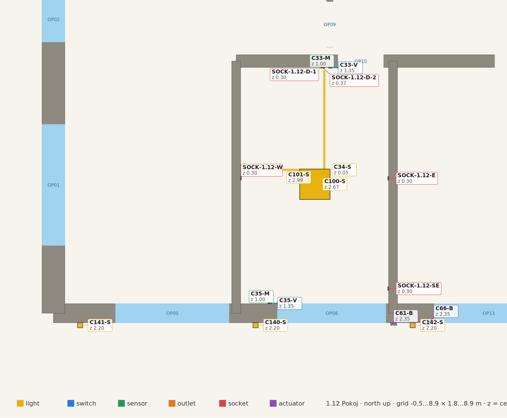

# 1.12 Pokoj: field devices

Source of truth: [`inputs/ground_floor/electrical-1.12.yaml`](../../../inputs/ground_floor/electrical-1.12.yaml). This page is generated from it by `python models/electrical_rooms_plan.py`; edit the YAML, not this page.

Sources: FixturePlan.pdf (Petr's marks on the floor plan) for positions, CableSchedule.xlsx sheet Soupis for cables. House rules: [PlanNotes.md](../PlanNotes.md). Naming: [Rooms.md](../Rooms.md). All open questions: [Questions.md](../Questions.md).

| Id | Cable | Code | Type | x | y | z (centre) | Notes |
| --- | --- | --- | --- | --- | --- | --- | --- |
| `C34-S` | 34 | S | LedStrip | path |  |  | Plan mark 2(034). L along the drawn bed outline (south and east sides), at floor level like the bedroom under-bed strip. No box; the viewer draws the legs from Path (x,y,z points; \| separates runs). |
| `C100-S` | 100 | S | Pendant | 5.39 | 5.64 | 2.67 | Plan mark 2(100). Plan symbol D600. Up-down pendant D600, hung 0.30 m below the 3.00 m ceiling (drop assumed). Which of 100/101 is the light and which the halo is assumed. |
| `C101-S` | 101 | S | LedStrip | 5.39 | 5.64 | 2.99 | Plan mark 2(101). Plan symbol Halo600. LED halo above the D600, at the ceiling. |
| `C140-S` | 140 | S | OutdoorLamp | 4.22 | 2.85 | 2.20 | Plan mark 7(140). Plan symbol Out-door. |
| `C141-S` | 141 | S | OutdoorLamp | 0.75 | 2.85 | 2.20 | Plan mark 7(141). Plan symbol Out-door. Bedroom south facade lamp, chained from 140 (Soupis: napojen na 140). |
| `C142-S` | 142 | S | OutdoorLamp | 7.33 | 2.85 | 2.20 | Plan mark 7(142). Plan symbol Out-door. 1.13 south facade lamp, chained from 140. |
| `C33-V` | 33 | V | PushButton | 5.70 | 7.94 | 1.35 | Plan mark 1(033). Controls: C34-S, C100-S, C101-S. |
| `C35-V` | 35 | V | PushButton | 4.50 | 3.28 | 1.35 | Plan mark 1(035). South wall, 150 mm west of the OP08 window jamb. Controls: C34-S, C100-S, C101-S. |
| `C33-R` | 33 | R | MmWavePresence | in C33-V |  |  | Plan mark 1(033). Inside the box of C33-V; no body of its own. |
| `C33-M` | 33 | M | DoorContact | 5.85 | 7.94 | 1.00 | Plan mark 1(033). |
| `C35-M` | 35 | M | WindowContact | 4.65 | 3.28 | 1.00 | Plan mark 1(035). |
| `SOCK-1.12-W` |  |  | Socket | 3.93 | 5.76 | 0.30 |  |
| `SOCK-1.12-E` |  |  | Socket | 6.84 | 5.75 | 0.30 |  |
| `SOCK-1.12-SE` |  |  | Socket | 6.84 | 3.58 | 0.30 |  |
| `SOCK-1.12-D-1` |  |  | Socket | 5.55 | 7.94 | 0.30 |  |
| `SOCK-1.12-D-2` |  |  | Socket | 5.55 | 7.94 | 0.37 |  |
| `C61-B` | 61 | B | BlindActuator | 6.95 | 2.88 | 2.35 | Plan mark 4(61). |
| `C66-B` | 66 | B | BlindActuator | 7.60 | 2.88 | 2.35 | Plan mark 4(66). 1.13 window blind; Soupis lists it under 1.12 (room of the penetration). |

## Open questions

- `C34-S`: C34/C75/C76 L strips in 1.12–1.14 follow the drawn bed outline. Floor level (under the bed) assumed — or are they something else?
- `C141-S`: C141 is the bedroom south-facade lamp (LAMP-X-S, parked in the bedroom work). The plan marks it 7(141); I placed it as C141-S. Delete in edit mode if it should stay parked.
