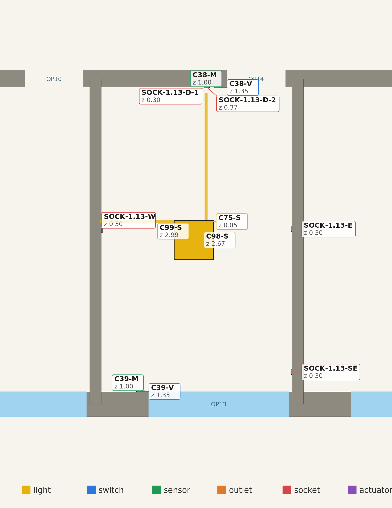

# 1.13 Pokoj: field devices

Source of truth: [`inputs/ground_floor/electrical-1.13.yaml`](../../../inputs/ground_floor/electrical-1.13.yaml). This page is generated from it by `python models/electrical_rooms_plan.py`; edit the YAML, not this page.

Sources: FixturePlan.pdf (Petr's marks on the floor plan) for positions, CableSchedule.xlsx sheet Soupis for cables. House rules: [PlanNotes.md](../PlanNotes.md). Naming: [Rooms.md](../Rooms.md). All open questions: [Questions.md](../Questions.md).

| Id | Cable | Code | Type | x | y | z (centre) | Notes |
| --- | --- | --- | --- | --- | --- | --- | --- |
| `C75-S` | 75 | S | LedStrip | path |  |  | Plan mark 2(075). No box; the viewer draws the legs from Path (x,y,z points; \| separates runs). |
| `C98-S` | 98 | S | Pendant | 8.45 | 5.60 | 2.67 | Plan mark 3(098). Plan symbol D600. D600 on 4x2.5 (main light), hung 0.30 m below the ceiling. |
| `C99-S` | 99 | S | LedStrip | 8.45 | 5.60 | 2.99 | Plan mark 2(099). Plan symbol Halo600. |
| `C38-V` | 38 | V | PushButton | 8.80 | 7.94 | 1.35 | Plan mark 1(038). Controls: C75-S, C98-S, C99-S. |
| `C39-V` | 39 | V | PushButton | 7.60 | 3.28 | 1.35 | Plan mark 1(039). Controls: C75-S, C98-S, C99-S. |
| `C38-R` | 38 | R | MmWavePresence | in C38-V |  |  | Plan mark 1(038). Inside the box of C38-V; no body of its own. |
| `C38-M` | 38 | M | DoorContact | 8.95 | 7.94 | 1.00 | Plan mark 1(038). |
| `C39-M` | 39 | M | WindowContact | 7.75 | 3.28 | 1.00 | Plan mark 1(039). |
| `SOCK-1.13-W` |  |  | Socket | 7.03 | 5.75 | 0.30 |  |
| `SOCK-1.13-E` |  |  | Socket | 9.94 | 5.77 | 0.30 |  |
| `SOCK-1.13-SE` |  |  | Socket | 9.94 | 3.58 | 0.30 |  |
| `SOCK-1.13-D-1` |  |  | Socket | 8.65 | 7.94 | 0.30 |  |
| `SOCK-1.13-D-2` |  |  | Socket | 8.65 | 7.94 | 0.37 |  |

## Open questions

None for this room.
