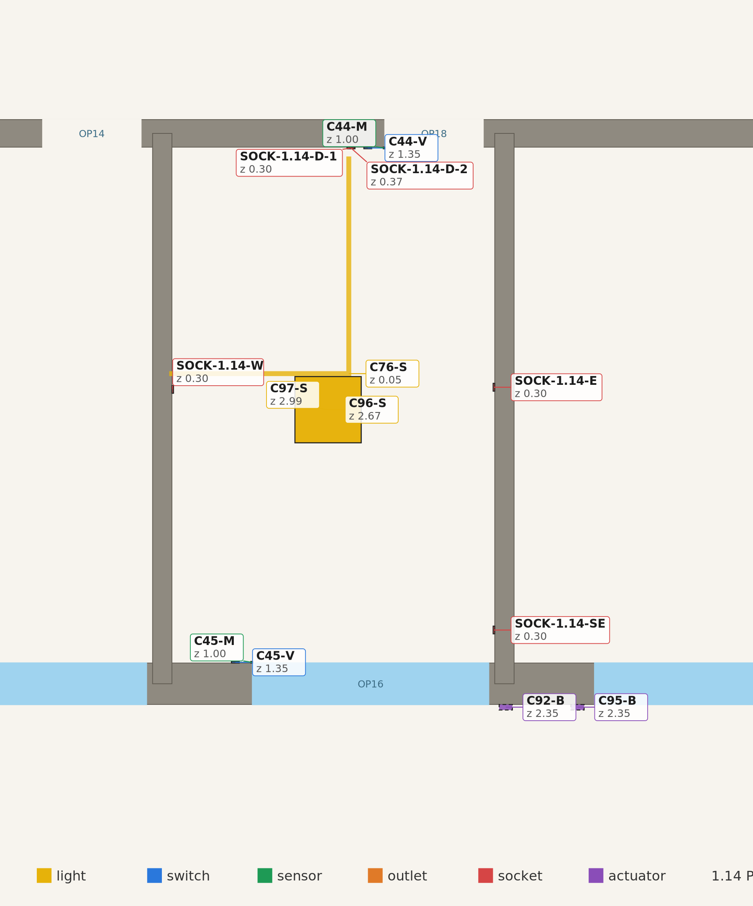

# 1.14 Pokoj: field devices

Source of truth: [`inputs/ground_floor/electrical-1.14.yaml`](../../../inputs/ground_floor/electrical-1.14.yaml). This page is generated from it by `python models/electrical_rooms_plan.py`; edit the YAML, not this page.

Sources: FixturePlan.pdf (Petr's marks on the floor plan) for positions, CableSchedule.xlsx sheet Soupis for cables. House rules: [PlanNotes.md](../PlanNotes.md). Naming: [Rooms.md](../Rooms.md). All open questions: [Questions.md](../Questions.md).

| Id | Cable | Code | Type | x | y | z (centre) | Notes |
| --- | --- | --- | --- | --- | --- | --- | --- |
| `C76-S` | 76 | S | LedStrip | path |  |  | Plan mark 2(076). No box; the viewer draws the legs from Path (x,y,z points; \| separates runs). |
| `C96-S` | 96 | S | Pendant | 11.54 | 5.57 | 2.67 | Plan mark 3(096). Plan symbol D600. D600 on 4x2.5 (main light), hung 0.30 m below the ceiling. |
| `C97-S` | 97 | S | LedStrip | 11.54 | 5.57 | 2.99 | Plan mark 2(097). Plan symbol Halo600. |
| `C44-V` | 44 | V | PushButton | 11.90 | 7.94 | 1.35 | Plan mark 1(044). Controls: C76-S, C96-S, C97-S. |
| `C45-V` | 45 | V | PushButton | 10.70 | 3.28 | 1.35 | Plan mark 1(045). Controls: C76-S, C96-S, C97-S. |
| `C44-R` | 44 | R | MmWavePresence | in C44-V |  |  | Plan mark 1(044). Inside the box of C44-V; no body of its own. |
| `C44-M` | 44 | M | DoorContact | 12.05 | 7.94 | 1.00 | Plan mark 1(044). |
| `C45-M` | 45 | M | WindowContact | 10.85 | 3.28 | 1.00 | Plan mark 1(045). |
| `SOCK-1.14-W` |  |  | Socket | 10.13 | 5.75 | 0.30 |  |
| `SOCK-1.14-E` |  |  | Socket | 13.04 | 5.77 | 0.30 |  |
| `SOCK-1.14-SE` |  |  | Socket | 13.04 | 3.58 | 0.30 |  |
| `SOCK-1.14-D-1` |  |  | Socket | 11.75 | 7.94 | 0.30 |  |
| `SOCK-1.14-D-2` |  |  | Socket | 11.75 | 7.94 | 0.37 |  |
| `C92-B` | 92 | B | BlindActuator | 13.15 | 2.88 | 2.35 | Plan mark 4(92). |
| `C95-B` | 95 | B | BlindActuator | 13.80 | 2.88 | 2.35 | Plan mark 4(95). 1.15 window blind; Soupis lists it under 1.14. |

## Open questions

None for this room.
