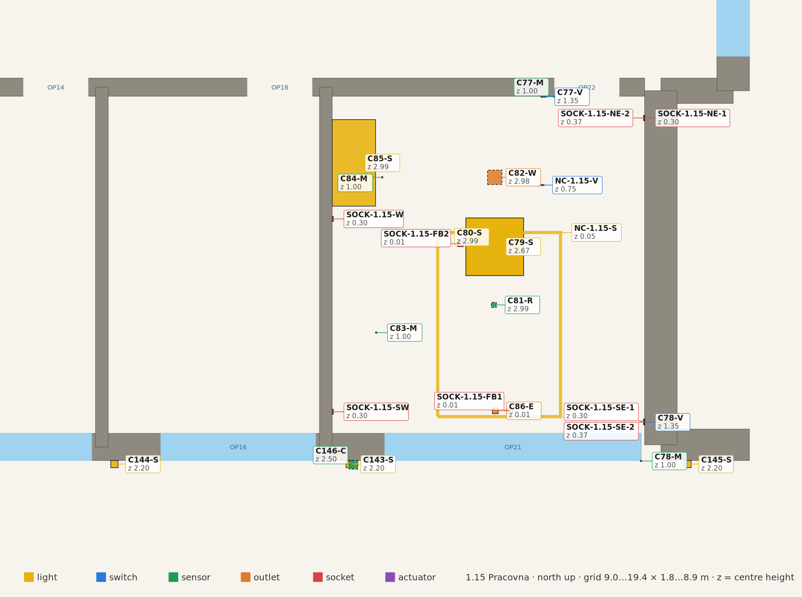

# 1.15 Pracovna: field devices

Source of truth: [`inputs/ground_floor/electrical-1.15.yaml`](../../../inputs/ground_floor/electrical-1.15.yaml). This page is generated from it by `python models/electrical_rooms_plan.py`; edit the YAML, not this page.

Sources: FixturePlan.pdf (Petr's marks on the floor plan) for positions, CableSchedule.xlsx sheet Soupis for cables. House rules: [PlanNotes.md](../PlanNotes.md). Naming: [Rooms.md](../Rooms.md). All open questions: [Questions.md](../Questions.md).

| Id | Cable | Code | Type | x | y | z (centre) | Notes |
| --- | --- | --- | --- | --- | --- | --- | --- |
| `C79-S` | 79 | S | Pendant | 15.47 | 5.86 | 2.67 | Plan mark 3(079). Plan symbol D800. Up-down pendant D800, hung 0.30 m below the ceiling. |
| `C80-S` | 80 | S | LedStrip | 15.47 | 5.86 | 2.99 | Plan mark 2(080). Plan symbol Halo800. |
| `C85-S` | 85 | S | Panel | 13.52 | 7.03 | 2.99 | Plan mark 3(085). Plan symbol Panel 600x1200. Plan: "Panel 600x1200 (~240 W)". |
| `C143-S` | 143 | S | OutdoorLamp | 13.47 | 2.85 | 2.20 | Plan mark 7(143). Plan symbol Out-door. |
| `C144-S` | 144 | S | OutdoorLamp | 10.21 | 2.85 | 2.20 | Plan mark 7(144). Plan symbol Out-door. 1.14 south facade lamp, chained from 143. |
| `C145-S` | 145 | S | OutdoorLamp | 18.14 | 2.85 | 2.20 | Plan mark 7(145). Plan symbol Out-door. Outdoor-kitchen south facade lamp, chained from 143. |
| `NC-1.15-S` |  | S | LedStrip | path |  |  | Drawn strip around the bed outline; no cable mark. No box; the viewer draws the legs from Path (x,y,z points; \| separates runs). |
| `C77-V` | 77 | V | PushButton | 16.15 | 7.94 | 1.35 | Plan mark 1(077). Controls: C79-S, C80-S, C85-S, NC-1.15-S. |
| `C78-V` | 78 | V | PushButton | 17.54 | 3.43 | 1.35 | Plan mark 1(078). East wall by the window; Soupis: 30 mm deep box because of the slatwall. Controls: C79-S, C80-S, C85-S, NC-1.15-S. |
| `NC-1.15-V` |  | V | PushButton | 16.12 | 6.72 | 0.75 | Unlabelled button symbol at the desk (x 16.12, y 6.73), placed at desk height. Controls: C79-S, C80-S, C85-S, NC-1.15-S. |
| `C77-M` | 77 | M | DoorContact | 16.30 | 7.94 | 1.00 | Plan mark 1(077). |
| `C78-M` | 78 | M | WindowContact | 17.50 | 2.89 | 1.00 | Plan mark 1(078). |
| `C81-R` | 81 | R | MmWavePresence | 15.46 | 5.06 | 2.99 | Plan mark 1(081). |
| `C83-M` | 83 | M | DoorContact | 13.83 | 4.67 | 1.00 | Plan mark 1(083). |
| `C84-M` | 84 | M | DoorContact | 13.92 | 6.83 | 1.00 | Plan mark 1(084). |
| `C146-C` | 146 | C | Camera | 13.52 | 2.84 | 2.50 | Plan mark (none). Plan: "G6 180 PoE+" on the south facade. |
| `C82-W` | 82 | W | WifiAccessPoint | 15.47 | 6.82 | 2.98 | Plan mark 1(082). Plan: "U7 Pro na stropě". |
| `C86-E` | 86 | E | Ethernet | 15.48 | 3.59 | 0.01 | Plan mark 1(086). Floor box by the window (the south wall is glazing here). |
| `SOCK-1.15-FB1` |  |  | Socket | 15.68 | 3.59 | 0.01 | Floor box next to C86-E. |
| `SOCK-1.15-FB2` |  |  | Socket | 15.00 | 5.90 | 0.01 | Floor conduit end for the desk and bed cable management (plan note: a cover with a cable gland is enough, no pop-up socket). |
| `SOCK-1.15-W` |  |  | Socket | 13.23 | 6.25 | 0.30 |  |
| `SOCK-1.15-SW` |  |  | Socket | 13.23 | 3.58 | 0.30 |  |
| `SOCK-1.15-SE-1` |  |  | Socket | 17.54 | 3.44 | 0.30 |  |
| `SOCK-1.15-SE-2` |  |  | Socket | 17.54 | 3.44 | 0.37 |  |
| `SOCK-1.15-NE-1` |  |  | Socket | 17.54 | 7.65 | 0.30 |  |
| `SOCK-1.15-NE-2` |  |  | Socket | 17.54 | 7.65 | 0.37 |  |

## Open questions

- `NC-1.15-S`: 1.15 has a strip drawn around the bed outline with no cable number. Is it a fixture, and on which cable?
- `NC-1.15-V`: Unlabelled button by the 1.15 desk: which cable, and is it on the desk?
- `C83-M`: 1.15 contacts C83 and C84 sit in the room near the west wall with no door or window there. What do they sense (furniture doors?)
- `C86-E`: C86 ethernet and its socket by the 1.15 window: the wall there is full-height glazing, so they are modelled as a floor box. Right?
