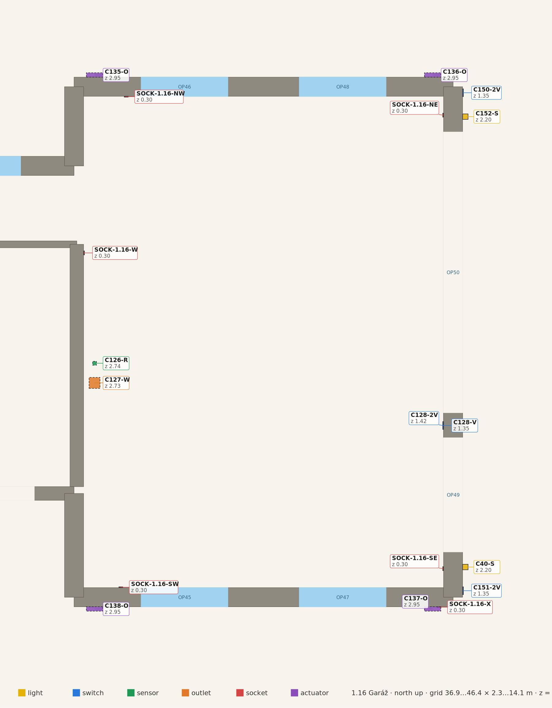

# 1.16 Garáž: field devices

Source of truth: [`inputs/ground_floor/electrical-1.16.yaml`](../../../inputs/ground_floor/electrical-1.16.yaml). This page is generated from it by `python models/electrical_rooms_plan.py`; edit the YAML, not this page.

Sources: FixturePlan.pdf (Petr's marks on the floor plan) for positions, CableSchedule.xlsx sheet Soupis for cables. House rules: [PlanNotes.md](../PlanNotes.md). Naming: [Rooms.md](../Rooms.md). All open questions: [Questions.md](../Questions.md).

| Id | Cable | Code | Type | x | y | z (centre) | Notes |
| --- | --- | --- | --- | --- | --- | --- | --- |
| `C15-S` | 15 | S | CeilingLight | — |  |  | Plan symbol Ceiling. Soupis: cable for the 400 W garage lights into a box; Petr runs the rest in surface conduit. No position on the plan. No position on the plan; no body. |
| `C152-S` | 152 | S | OutdoorLamp | 45.10 | 12.33 | 2.20 | Plan mark 7(152). Plan symbol Out-door. |
| `C40-S` | 40 | S | OutdoorLamp | 45.10 | 4.08 | 2.20 | Plan mark 7(40). Plan symbol Out-door. Chained from 152 (Soupis row 40 has no room). |
| `C128-V` | 128 | V | PushButton | 44.69 | 6.67 | 1.35 | Plan mark 1(128). Pier between the two garage doors. Controls: C15-S. |
| `C128-2V` | 128 | 2V | DoublePushButton | 44.69 | 6.67 | 1.42 | Plan mark 1(128). Controls: C15-S. |
| `C150-2V` | 150 | 2V | DoublePushButton | 45.06 | 12.77 | 1.35 | Plan mark 1(150). Controls: C152-S, C40-S. |
| `C151-2V` | 151 | 2V | DoublePushButton | 45.06 | 3.64 | 1.35 | Plan mark 1(151). Controls: C152-S, C40-S. |
| `C126-R` | 126 | R | MmWavePresence | 38.30 | 7.81 | 2.74 | Plan mark 1(126). Drawn on the west wall; modelled on the ceiling next to it. |
| `C127-W` | 127 | W | WifiAccessPoint | 38.30 | 7.45 | 2.73 | Plan mark 1(127). Drawn on the west wall; modelled on the ceiling next to it. |
| `SOCK-1.16-W` |  |  | Socket | 38.11 | 9.83 | 0.30 |  |
| `SOCK-1.16-NW` |  |  | Socket | 38.88 | 12.69 | 0.30 |  |
| `SOCK-1.16-NE` |  |  | Socket | 44.69 | 12.35 | 0.30 |  |
| `SOCK-1.16-SE` |  |  | Socket | 44.69 | 4.05 | 0.30 |  |
| `SOCK-1.16-SW` |  |  | Socket | 38.78 | 3.71 | 0.30 |  |
| `SOCK-1.16-X` |  |  | Socket | 44.62 | 3.34 | 0.30 |  |
| `C135-O` | 135 | O | GutterHeating | 38.30 | 13.09 | 2.95 | Plan mark 4(135). |
| `C136-O` | 136 | O | GutterHeating | 44.50 | 13.09 | 2.95 | Plan mark 4(136). |
| `C137-O` | 137 | O | GutterHeating | 44.50 | 3.31 | 2.95 | Plan mark 4(137). |
| `C138-O` | 138 | O | GutterHeating | 38.30 | 3.31 | 2.95 | Plan mark 4(138). Soupis: the cable hangs outside by the garsonka entrance. |

## Open questions

- `C128-2V`: Cable 128 (garage) is V,2V; the plan draws one button. The 2V is stacked above as a guess.
