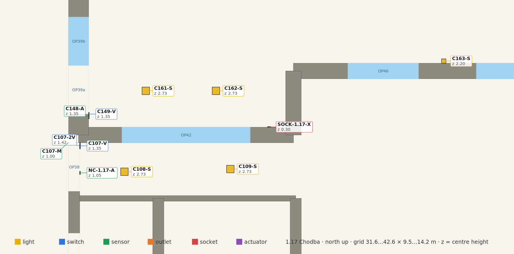

# 1.17 Chodba: field devices

Source of truth: [`inputs/ground_floor/electrical-1.17.yaml`](../../../inputs/ground_floor/electrical-1.17.yaml). This page is generated from it by `python models/electrical_rooms_plan.py`; edit the YAML, not this page.

Sources: FixturePlan.pdf (Petr's marks on the floor plan) for positions, CableSchedule.xlsx sheet Soupis for cables. House rules: [PlanNotes.md](../PlanNotes.md). Naming: [Rooms.md](../Rooms.md). All open questions: [Questions.md](../Questions.md).

| Id | Cable | Code | Type | x | y | z (centre) | Notes |
| --- | --- | --- | --- | --- | --- | --- | --- |
| `C108-S` | 108 | S | Downlight | 34.11 | 10.59 | 2.73 | Plan mark 2(108). Plan symbol PLP 170R. |
| `C109-S` | 109 | S | Downlight | 36.50 | 10.65 | 2.73 | Plan mark 2(109). Plan symbol PLP 170R. |
| `C161-S` | 161 | S | CeilingLight | 34.59 | 12.43 | 2.73 | Plan mark 2(161). Plan symbol Ceiling. Entrance porch ceiling; height 2.75 assumed. |
| `C162-S` | 162 | S | CeilingLight | 36.18 | 12.43 | 2.73 | Plan mark 2(162). Plan symbol Ceiling. Entrance porch ceiling, chained from 161. |
| `C163-S` | 163 | S | OutdoorLamp | 41.32 | 13.10 | 2.20 | Plan mark 2(163). Plan symbol Out-door. Garage north facade, chained from 162 (Soupis). |
| `C107-V` | 107 | V | PushButton | 33.11 | 11.18 | 1.35 | Plan mark 1(107). Controls: C108-S, C109-S. |
| `C107-2V` | 107 | 2V | DoublePushButton | 33.11 | 11.18 | 1.42 | Plan mark 1(107). Controls: C108-S, C109-S. |
| `C149-V` | 149 | V | PushButton | 33.31 | 11.90 | 1.35 | Plan mark 1(149). Same 2-gang facade box as C148-A. Controls: C161-S, C162-S, C163-S. |
| `C107-M` | 107 | M | DoorContact | 32.84 | 11.25 | 1.00 | Plan mark 1(107). |
| `C148-A` | 148 | A | AliroReader | 33.31 | 11.83 | 1.35 | Plan mark 1(148). Facade box at the entrance (plan note: 2-gang box in the cement-board facade, 1 UTP ethernet to the ESP32, 1 UTP powering the ESP32 + button; Aliro hardware under a Jung blank). Cable 149 also feeds it. |
| `NC-1.17-A` |  | A | AliroReader | 33.11 | 10.57 | 1.05 | Key symbol at OP38, no cable mark. |
| `SOCK-1.17-X` |  |  | Socket | 37.38 | 11.61 | 0.30 | Entrance porch socket. |

## Open questions

- `C107-2V`: Cable 107 (1.17) is V,2V,M but the plan draws one button. The 2V is stacked above C107-V as a guess.
