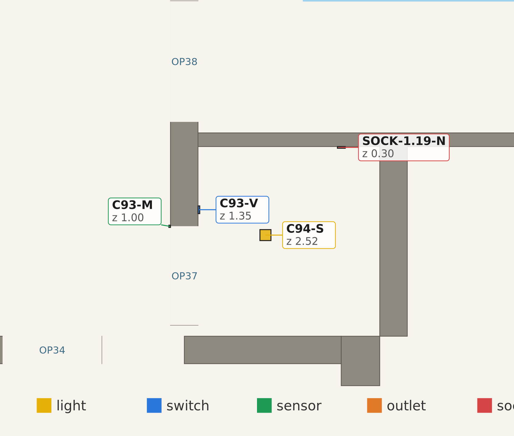

# 1.19 WC: field devices

Source of truth: [`inputs/ground_floor/electrical-1.19.yaml`](../../../inputs/ground_floor/electrical-1.19.yaml). This page is generated from it by `python models/electrical_rooms_plan.py`; edit the YAML, not this page.

Sources: FixturePlan.pdf (Petr's marks on the floor plan) for positions, CableSchedule.xlsx sheet Soupis for cables. House rules: [PlanNotes.md](../PlanNotes.md). Naming: [Rooms.md](../Rooms.md). All open questions: [Questions.md](../Questions.md).

| Id | Cable | Code | Type | x | y | z (centre) | Notes |
| --- | --- | --- | --- | --- | --- | --- | --- |
| `C94-S` | 94 | S | Downlight | 33.71 | 9.12 | 2.52 | Plan mark 2(094). Plan symbol D100. |
| `C93-V` | 93 | V | PushButton | 33.11 | 9.35 | 1.35 | Plan mark 1(093). Controls: C94-S. |
| `C93-M` | 93 | M | DoorContact | 32.84 | 9.20 | 1.00 | Plan mark 1(093). |
| `NC-1.19-R` |  | R | MmWavePresence | in C93-V |  |  | Radar drawn by the 1.19 switch; Soupis cable 93 is V,M only. Inside the box of C93-V; no body of its own. |
| `SOCK-1.19-N` |  |  | Socket | 34.40 | 9.92 | 0.30 |  |

## Open questions

- `NC-1.19-R`: 1.19 WC: a radar is drawn by the switch but cable 93 is V,M. Add R to 93?
