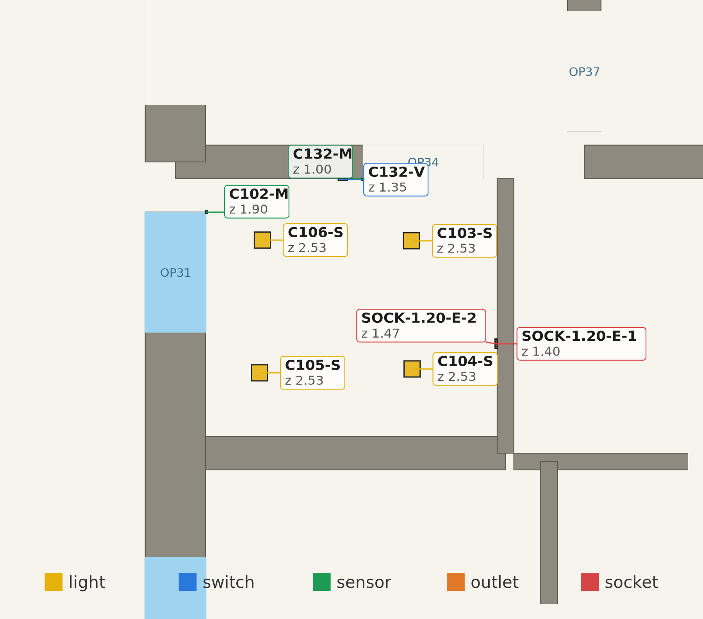

# 1.20 Koupelna: field devices

Source of truth: [`inputs/ground_floor/electrical-1.20.yaml`](../../../inputs/ground_floor/electrical-1.20.yaml). This page is generated from it by `python models/electrical_rooms_plan.py`; edit the YAML, not this page.

Sources: FixturePlan.pdf (Petr's marks on the floor plan) for positions, CableSchedule.xlsx sheet Soupis for cables. House rules: [PlanNotes.md](../PlanNotes.md). Naming: [Rooms.md](../Rooms.md). All open questions: [Questions.md](../Questions.md).

| Id | Cable | Code | Type | x | y | z (centre) | Notes |
| --- | --- | --- | --- | --- | --- | --- | --- |
| `C103-S` | 103 | S | Downlight | 31.69 | 7.49 | 2.53 | Plan mark 2(103). Plan symbol LP 120R. |
| `C104-S` | 104 | S | Downlight | 31.69 | 6.53 | 2.53 | Plan mark 2(104). Plan symbol LP 120R. |
| `C105-S` | 105 | S | Downlight | 30.55 | 6.50 | 2.53 | Plan mark 2(105). Plan symbol LP 120R. |
| `C106-S` | 106 | S | Downlight | 30.57 | 7.49 | 2.53 | Plan mark 2(106). Plan symbol LP 120R. |
| `C132-V` | 132 | V | PushButton | 31.17 | 7.94 | 1.35 | Plan mark 1(132). Controls: C103-S, C104-S, C105-S, C106-S. |
| `C132-R` | 132 | R | MmWavePresence | in C132-V |  |  | Plan mark 1(132). Inside the box of C132-V; no body of its own. |
| `C132-M` | 132 | M | DoorContact | 31.33 | 7.94 | 1.00 | Plan mark 1(132). |
| `C102-M` | 102 | M | WindowContact | 30.16 | 7.70 | 1.90 | Plan mark 1(102). |
| `SOCK-1.20-E-1` |  |  | Socket | 32.32 | 6.72 | 1.40 |  |
| `SOCK-1.20-E-2` |  |  | Socket | 32.32 | 6.72 | 1.47 |  |

## Open questions

None for this room.
