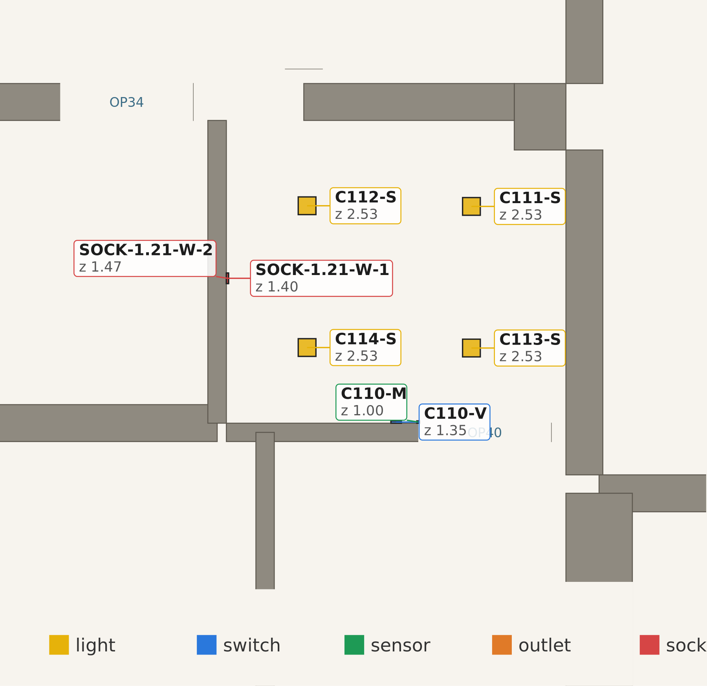

# 1.21 Koupelna: field devices

Source of truth: [`inputs/ground_floor/electrical-1.21.yaml`](../../../inputs/ground_floor/electrical-1.21.yaml). This page is generated from it by `python models/electrical_rooms_plan.py`; edit the YAML, not this page.

Sources: FixturePlan.pdf (Petr's marks on the floor plan) for positions, CableSchedule.xlsx sheet Soupis for cables. House rules: [PlanNotes.md](../PlanNotes.md). Naming: [Rooms.md](../Rooms.md). All open questions: [Questions.md](../Questions.md).

| Id | Cable | Code | Type | x | y | z (centre) | Notes |
| --- | --- | --- | --- | --- | --- | --- | --- |
| `C111-S` | 111 | S | Downlight | 34.11 | 7.37 | 2.53 | Plan mark 2(111). Plan symbol PLP 120R. |
| `C112-S` | 112 | S | Downlight | 33.00 | 7.37 | 2.53 | Plan mark 2(112). Plan symbol PLP 120R. |
| `C113-S` | 113 | S | Downlight | 34.11 | 6.41 | 2.53 | Plan mark 2(113). Plan symbol PLP 120R. |
| `C114-S` | 114 | S | Downlight | 33.00 | 6.41 | 2.53 | Plan mark 2(114). Plan symbol PLP 120R. |
| `C110-V` | 110 | V | PushButton | 33.60 | 5.91 | 1.35 | Plan mark 1(110). Controls: C111-S, C112-S, C113-S, C114-S. |
| `C110-R` | 110 | R | MmWavePresence | in C110-V |  |  | Plan mark 1(110). Inside the box of C110-V; no body of its own. |
| `C110-M` | 110 | M | DoorContact | 33.75 | 5.91 | 1.00 | Plan mark 1(110). |
| `SOCK-1.21-W-1` |  |  | Socket | 32.46 | 6.88 | 1.40 |  |
| `SOCK-1.21-W-2` |  |  | Socket | 32.46 | 6.88 | 1.47 |  |

## Open questions

None for this room.
