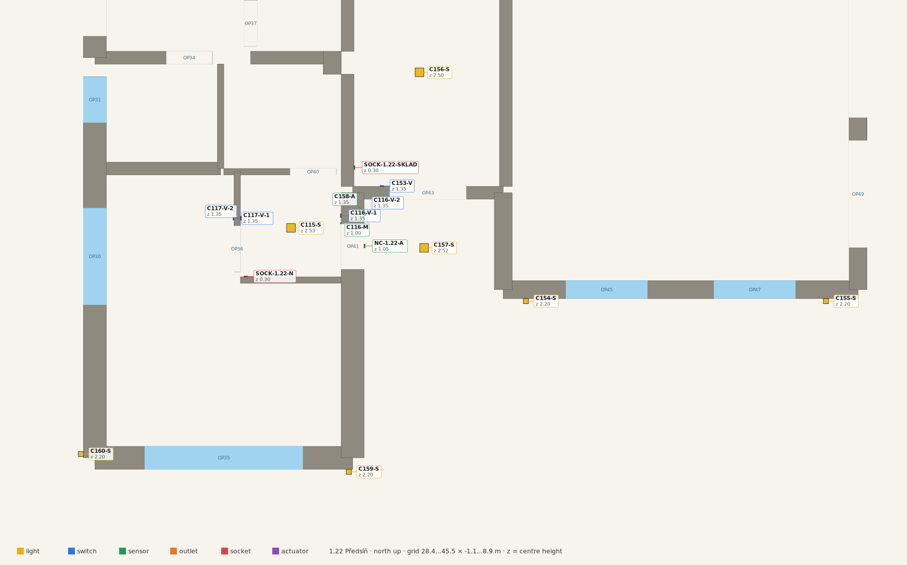

# 1.22 Předsíň: field devices

Source of truth: [`inputs/ground_floor/electrical-1.22.yaml`](../../../inputs/ground_floor/electrical-1.22.yaml). This page is generated from it by `python models/electrical_rooms_plan.py`; edit the YAML, not this page.

Sources: FixturePlan.pdf (Petr's marks on the floor plan) for positions, CableSchedule.xlsx sheet Soupis for cables. House rules: [PlanNotes.md](../PlanNotes.md). Naming: [Rooms.md](../Rooms.md). All open questions: [Questions.md](../Questions.md).

| Id | Cable | Code | Type | x | y | z (centre) | Notes |
| --- | --- | --- | --- | --- | --- | --- | --- |
| `C115-S` | 115 | S | Downlight | 33.77 | 4.74 | 2.53 | Plan mark 2(. Plan symbol LP 170R. |
| `C156-S` | 156 | S | CeilingLight | 36.28 | 7.79 | 2.50 | Plan mark 5(156). Plan symbol OutdoorCeiling. Storeroom (sklad) light, plan symbol Out-door; ceiling 2.55 assumed. |
| `C157-S` | 157 | S | CeilingLight | 36.37 | 4.34 | 2.52 | Plan mark 2(157). Plan symbol Ceiling. Covered entry niche in front of the garsonka; 2.55 assumed. |
| `C154-S` | 154 | S | OutdoorLamp | 38.37 | 3.30 | 2.20 | Plan mark 7(154). Plan symbol Out-door. |
| `C155-S` | 155 | S | OutdoorLamp | 44.25 | 3.30 | 2.20 | Plan mark 7(155). Plan symbol Out-door. Chained from 154. |
| `C159-S` | 159 | S | OutdoorLamp | 34.90 | -0.05 | 2.20 | Plan mark 7(159). Plan symbol Out-door. South facade, 300 mm from the outer corner. |
| `C160-S` | 160 | S | OutdoorLamp | 29.65 | 0.30 | 2.20 | Plan mark 7(160). Plan symbol Out-door. Chained from 159; west facade, 300 mm from the corner. |
| `C116-V-1` | 116 | V | PushButton | 34.74 | 4.97 | 1.35 | Plan mark 1(116). Controls: C115-S, C156-S. |
| `C116-V-2` | 116 | V | PushButton | 35.21 | 4.98 | 1.35 | Plan mark 1(116). Outside the garsonka door, 2-gang facade box with the Aliro reader. Controls: C157-S, C154-S, C155-S, C159-S, C160-S. |
| `C117-V-1` | 117 | V | PushButton | 32.64 | 4.92 | 1.35 | Plan mark 1(117). 1.23 side of the 1.22/1.23 opening. Controls: C115-S, C156-S. |
| `C117-V-2` | 117 | V | PushButton | 32.78 | 4.92 | 1.35 | Plan mark 1(117). 1.22 side of the opening. Controls: C115-S, C156-S. |
| `C153-V` | 153 | V | PushButton | 35.55 | 5.56 | 1.35 | Plan mark 1(153). In the storeroom (sklad); Soupis: penetration from panel 4. Controls: C115-S, C156-S. |
| `C116-M` | 116 | M | DoorContact | 34.74 | 4.83 | 1.00 | Plan mark 1(116). |
| `C158-A` | 158 | A | AliroReader | 35.21 | 5.05 | 1.35 | Plan mark 1(158). Plan note: 2-gang frame for Aliro and button; ESP32 in the panel. |
| `NC-1.22-A` |  | A | AliroReader | 35.21 | 4.38 | 1.05 | Key symbol at the garsonka door OP41, no cable mark. |
| `C153-R` | 153 | R | MmWavePresence | in C153-V |  |  | Plan mark 1(153). Inside the box of C153-V; no body of its own. |
| `C164-cisticka` | 164 | cisticka | ModbusLink | — |  |  | Topas 8 wastewater plant, Modbus link (plan note by the label at x 38.0, y 0.2). The plant is in the garden; no device position. No position on the plan; no body. |
| `SOCK-1.22-N` |  |  | Socket | 32.88 | 3.78 | 0.30 |  |
| `SOCK-1.22-SKLAD` |  |  | Socket | 35.01 | 5.92 | 0.30 |  |

## Open questions

- `C115-S`: 1.22 light mark reads only "2(" — assumed cable 115 (Soupis 1.22 S, 4x1.5).
