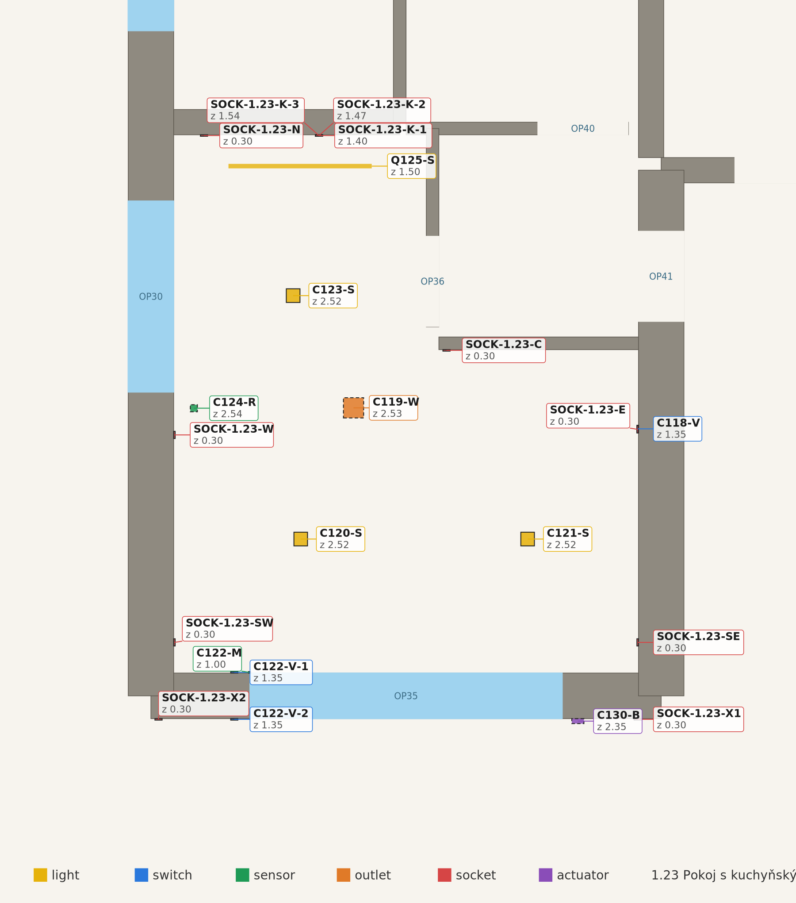

# 1.23 Pokoj s kuchyňským koutem: field devices

Source of truth: [`inputs/ground_floor/electrical-1.23.yaml`](../../../inputs/ground_floor/electrical-1.23.yaml). This page is generated from it by `python models/electrical_rooms_plan.py`; edit the YAML, not this page.

Sources: FixturePlan.pdf (Petr's marks on the floor plan) for positions, CableSchedule.xlsx sheet Soupis for cables. House rules: [PlanNotes.md](../PlanNotes.md). Naming: [Rooms.md](../Rooms.md). All open questions: [Questions.md](../Questions.md).

| Id | Cable | Code | Type | x | y | z (centre) | Notes |
| --- | --- | --- | --- | --- | --- | --- | --- |
| `C120-S` | 120 | S | Downlight | 31.41 | 1.78 | 2.52 | Plan mark 2(120). Plan symbol D135. |
| `C121-S` | 121 | S | Downlight | 33.65 | 1.78 | 2.52 | Plan mark 2(121). Plan symbol D135. |
| `C123-S` | 123 | S | Downlight | 31.33 | 4.18 | 2.52 | Plan mark 2(123). Plan symbol D135. |
| `Q125-S` | ? (plan 125) | S | LedStrip | path |  |  | Plan mark 2(125). No box; the viewer draws the legs from Path (x,y,z points; \| separates runs). |
| `C118-V` | 118 | V | PushButton | 34.74 | 2.87 | 1.35 | Plan mark 1(118). Controls: C120-S, C121-S, C123-S, Q125-S. |
| `C122-V-1` | 122 | V | PushButton | 30.75 | 0.46 | 1.35 | Plan mark 1(122). Controls: C120-S, C121-S, C123-S, Q125-S. |
| `C122-V-2` | 122 | V | PushButton | 30.75 | -0.01 | 1.35 | Plan mark 1(122). |
| `C122-M` | 122 | M | WindowContact | 30.90 | 0.46 | 1.00 | Plan mark 1(122). |
| `C124-R` | 124 | R | MmWavePresence | 30.35 | 3.07 | 2.54 | Plan mark 1(124). Drawn on the west wall; modelled on the ceiling next to it. |
| `C119-W` | 119 | W | WifiAccessPoint | 31.93 | 3.07 | 2.53 | Plan mark 1(119). Plan: "U7 Lite na stropě". |
| `SOCK-1.23-E` |  |  | Socket | 34.74 | 2.86 | 0.30 |  |
| `SOCK-1.23-SE` |  |  | Socket | 34.74 | 0.75 | 0.30 |  |
| `SOCK-1.23-SW` |  |  | Socket | 30.16 | 0.75 | 0.30 |  |
| `SOCK-1.23-W` |  |  | Socket | 30.16 | 2.81 | 0.30 |  |
| `SOCK-1.23-N` |  |  | Socket | 30.45 | 5.77 | 0.30 |  |
| `SOCK-1.23-K-1` |  |  | Socket | 31.59 | 5.77 | 1.40 | Kitchenette (plan "lednice" nearby); counter height. |
| `SOCK-1.23-K-2` |  |  | Socket | 31.59 | 5.77 | 1.47 | Kitchenette (plan "lednice" nearby); counter height. |
| `SOCK-1.23-K-3` |  |  | Socket | 31.59 | 5.77 | 1.54 | Kitchenette (plan "lednice" nearby); counter height. |
| `SOCK-1.23-C` |  |  | Socket | 32.85 | 3.64 | 0.30 |  |
| `SOCK-1.23-X1` |  |  | Socket | 34.74 | -0.01 | 0.30 |  |
| `SOCK-1.23-X2` |  |  | Socket | 30.00 | -0.01 | 0.30 | South facade, 300 mm from the outer corner. |
| `C130-B` | 130 | B | BlindActuator | 34.15 | -0.03 | 2.35 | Plan mark 4(130). |

## Open questions

- `Q125-S`: Kitchenette strip in 1.23 is marked 2(125); Soupis 125 is the 1.09 gutter. Which cable? (Height 1.50 under the cabinets assumed.)
- `C122-M`: 1.23: the plan draws a window contact on cable 122, but Soupis 122 is V,V (no M).
