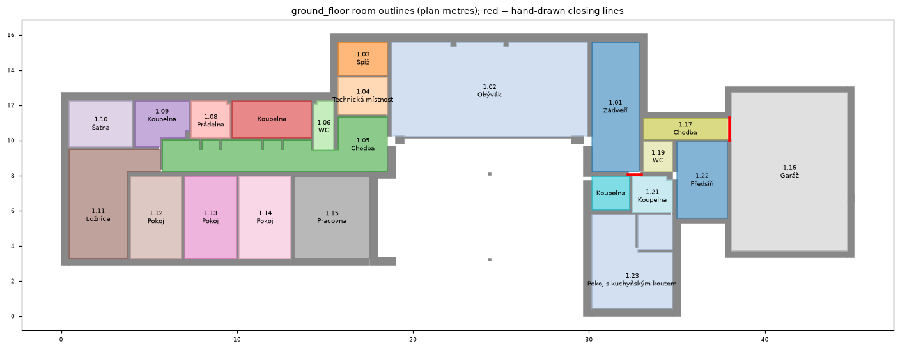

# Room isolate ("Only this room")

Source: Petr, 2026-11-19 (Cody chat): "Proceed on "hide/show other rooms" shortcut. Either based on camera position or camera target." On the call before that: "you could have a shortcut to like hide everything but this one room, and which room it is, it should be figured out by where my camera position is."

Code: `src/blueprints/room_outlines.py` (export), `models/ground_floor_rooms.py` (closing lines), `src/blueprints/viewer/roomIsolate.js` (viewer, tested in `roomIsolate.test.mjs`), wired in `main.js`.

## In the viewer

A chip at the end of the top bar names the room the view is in ("1.11 Ložnice") and has one button: **Only this room**, or **Show all rooms** while the isolate is on (the chip then has a blue ring). The room follows the camera: about every 250 ms while the camera moves, and a new room takes over once two checks in a row agree, so a sweep across the house does not flicker through every room.

Which room:

1. **Walk mode**: the room containing the camera (the eye's plan position).
2. **Orbit**: the room under the orbit target.
3. Else the room under the first drawn surface at the screen centre.
4. Else the room nearest the target.

What stays visible with **Only this room** on:

- everything contained in the room's IfcSpace (IFC containment, following aggregation up to a contained parent: a kitchen run's parts go with the run);
- the room's bounding walls, and the doors and windows in them on the room's side (`rooms[].bounding` in `ifc.json`);
- elements with no space (on the storey) whose plan centre lies inside the room's outline;
- slabs;
- anything locked ([VisibilityState.md](VisibilityState.md)). Enclosure is locked by default, so by default every wall, door and window in the house stays, and the isolate hides only other rooms' contents. Unlock Enclosure to see just the room's own walls.

It is kept apart from the inspector's own hides (its "Show all" does not end the isolate, and the chip does not undo inspector hides), and it is remembered per model with the rest of the visibility state. Reset turns it off. Hidden elements are not drawn, so an isolated room is also lighter to render.

## Room outlines

The IFC's 22 `IfcSpace` have no geometry. `python -m blueprints.export ground_floor` traces each room's floor outline from the wall footprints and writes it into `ground_floor.ifc.json` as `rooms`: `space` (yaml id), `outlines` (rings in plan metres, IFC x, y; the viewer's world is glTF, so plan (x, y) is (x, −z)), `area` (m²), `bounding` (yaml ids). No IFC geometry is added; the rest of `ifc.json` is unchanged.

How the outlines are traced (`room_outlines.py`):

1. Union of the wall footprints (`yaml_ifc.footprints`). Doorways need no closing line: openings are cut only in 3D, so a wall's plan footprint already runs across its doors and windows.
2. Gaps between walls that do not meet: a morphological closing (grow by 0.3 m, shrink back) shuts gaps up to 0.6 m; two wider ones have hand-drawn closing lines (`models/ground_floor_rooms.py`):
   - **1.01 | 1.20 | 1.21**: W-015 stops at x 32.2 and W-016 starts at x 32.975 on the same line (y 8.075). Without it the hall 1.01 and both bathrooms 1.20 and 1.21 are one region.
   - **1.16 | 1.17**: the passage from corridor 1.17 into the garage, between W-066 (ends y 10.05) and W-065 (starts y 11.6) at x 37.975.
3. The holes of that union are the rooms, named by majority vote of the `ContainedInStructure` of yaml products whose `Origin` falls inside. A space with no hole takes the nearest unnamed hole within 0.3 m of one of its products (1.04's only placed product sits on the wall face).

Result on 2026-11-19: all 22 spaces have an outline, no hole is left unnamed. Areas run from 2.85 m² (1.19 WC) to 59.5 m² (1.02 living room and kitchen, one open-plan space in the IFC, so one outline). One product of 1.22 lies inside 1.23's outline (`strayProducts`), which is a drawing detail, not an outline error. The open area south of 1.02 (between the two 120 mm columns W-004 and W-014) is outside the building line and is no room.

Red: the two hand-drawn closing lines.
